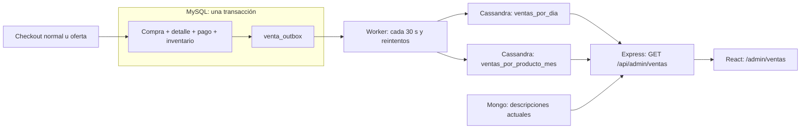

# ADR-004 — Analítica de ventas por intervalos con Cassandra

> Fecha: 2026-09-05. Decisión aceptada e implementada. Migración, carga histórica, consultas reales y compilación verificadas; detalle de evidencia en §9. Este ADR reemplaza la elección preliminar de Neo4j del 2026-08-30 en [ENTREGA-2-PLAN.md](ENTREGA-2-PLAN.md).

## 1. Contexto

El [PRD §5, Entrega 2](PRD.md#5-entregas-y-requerimientos) exige evaluar grafos frente a columnar e implementar **al menos una familia** con su reto específico. Para la opción columnar, pide un modelo orientado a intervalos de tiempo y una consulta que identifique variaciones de demanda entre períodos. El PRD incluye Apache Cassandra entre los motores de esa familia.

El equipo priorizó el panel de ventas y autorizó incorporar Cassandra al Docker Compose existente. MySQL ya conserva las compras del cliente, que representan ventas del comercio: `compra_detalle` contiene cantidades e importes y `compra` aporta fecha. Las compras normales, ofertas flash y ofertas recomendadas terminan en esos mismos registros. MongoDB mantiene el catálogo descriptivo; Redis resuelve carrito, cupos atómicos y recomendaciones temporales.

`Producto.total_vendido` en Mongo es una caché acumulada: no conserva fechas para comparar ventanas. `tendenciaService` calcula afinidad del comprador según su historial; no identifica productos con demanda reciente en ascenso.

## 2. Alternativas y decisión

| Alternativa | Aplicación en TiendaYa | Decisión |
|---|---|---|
| Cassandra, familia de columnas anchas (*wide-column*) | Lecturas por partición temporal y producto; proyección de ventas desde MySQL | Seleccionada para el panel y el reto columnar del PRD |
| Neo4j, grafos | Relaciones entre cuentas, reseñas y productos; detección de patrones coordinados mediante recorridos de varios saltos | Aplazada: las reseñas y sus flujos de captura todavía no están implementados |
| Agregaciones directamente en MySQL o MongoDB | Suficientes para el volumen actual de desarrollo | No cubren por sí solas la incorporación de una familia seleccionada que exige esta entrega |
| Ambas familias | Cubriría ventas y fraude | Permitido por el PRD, pero el alcance actual prioriza ventas; no hay un requisito operativo demostrado para sumar ambas ahora |

Se incorpora **Cassandra como copia analítica de lectura**. No se migra el checkout ni la autoridad sobre inventario, pedidos o pagos. La elección responde al objetivo docente y a consultas concretas del panel; no se afirma que el volumen de desarrollo necesite Cassandra por rendimiento.

Cassandra es una base de **columnas anchas**, según la familia denominada columnar por el PRD. El diseño aprovecha claves de partición y orden de filas dentro de una partición. No se plantea como un motor SQL analítico que ejecuta joins y agregaciones arbitrarias entre tablas: la API consulta particiones conocidas y agrupa un conjunto acotado de resultados.

## 3. Fuente y significado de una venta

La unidad de réplica es una línea de `compra_detalle`, identificada por su `id`:

| Dato | Fuente | Interpretación |
|---|---|---|
| `detalle_id` | `compra_detalle.id` | Identidad estable de una línea; permite reintentos sin sumar duplicados |
| `compra_id` | `compra_detalle.id_compra` | Identifica el pedido; varios productos del mismo pedido no son varios pedidos |
| `producto_id` | `compra_detalle.id_producto` | Referencia al producto SQL y a `Producto.producto_id` de Mongo |
| `fecha_venta` | `compra.fecha` | Instante de la compra; determina día y mes en Guatemala |
| `cantidad` | `compra_detalle.cantidad` | Unidades vendidas, indicador de demanda usado por el panel |
| `precio_final` | `compra_detalle.precio_final` | Importe neto **total de la línea**, ya descontado |
| `descuento` | `compra_detalle.descuento` | Ahorro total de esa línea, no porcentaje ni descuento unitario |

Una compra se considera pagada cuando **existe** un `pago` relacionado con `estado = 'aprobado'`. La extracción histórica usa `EXISTS` o su equivalente, para que varios pagos asociados no multipliquen líneas. El detalle permanece en `estado = 'pendiente'` aun cuando el pago está aprobado; exigir un detalle `completado` descartaría las ventas que genera el checkout actual.

Los importes se guardan como `decimal` y se trasladan como valores decimales exactos. Los ingresos son la suma de `precio_final`: no se multiplica otra vez por cantidad ni se vuelve a restar descuento. Las unidades se suman por producto; el conteo de pedidos deduplica `compra_id`.

El estado aprobado se genera por la lógica de pago de demostración existente. No hay cancelaciones ni reembolsos implementados. Incorporarlos exige eventos de ajuste y reglas de ingresos netos; no bastaría con continuar agregando ventas como si fueran inmutables.

## 4. Modelo de Cassandra guiado por consultas

Se guardan dos proyecciones de la misma venta, con la misma identidad y valores:

| Tabla | Clave primaria CQL | Consulta que resuelve |
|---|---|---|
| `ventas_por_dia` | `PRIMARY KEY ((dia), fecha_venta, detalle_id)` | Ventas de todos los productos en cada día solicitado |
| `ventas_por_producto_mes` | `PRIMARY KEY ((producto_id, mes), fecha_venta, detalle_id)` | Ventas de un producto dentro de los meses que atraviesa el rango |

`dia` y `mes` se derivan de la fecha de la venta en Guatemala (UTC−6); `fecha_venta` conserva el instante completo. El segundo componente de orden, `detalle_id`, permite que dos líneas compartan instante sin sobrescribirse. La fecha de la compra y el producto de una línea son estables bajo los flujos actuales.

La duplicación es deliberada: cada tabla responde a un acceso distinto sin buscar productos mediante `ALLOW FILTERING` ni recorrer toda la base. Para un rango de todos los productos se enumeran sus particiones diarias; si se selecciona producto, se consultan únicamente sus particiones mensuales y límites de fecha. El backend pagina la lectura y agrega los resultados dentro de límites explícitos; no se promete costo constante frente al número de ventas.

No se usan contadores incrementales para representar ingresos o unidades. Reinsertar una línea conserva su clave primaria y sus valores, por lo que la réplica es idempotente. Un reintento puede completar la segunda tabla si falló después de escribir la primera.

## 5. Outbox transaccional y sincronización

`venta_outbox` en MySQL contiene `detalle_id` como clave primaria, `payload`, `procesado_en`, `intentos`, `proximo_intento` y `ultimo_error`. El payload conserva los datos de la línea necesarios para reconstruir las dos proyecciones.

1. Los dos métodos de checkout crean la venta y su outbox **dentro de la misma transacción MySQL**. Si esta se revierte, tampoco queda un evento para replicar. Esto cubre carrito, oferta flash y oferta recomendada.
2. El worker recoge entradas pendientes cuyo próximo intento ya corresponde. El intervalo por defecto es 30 segundos y puede configurarse.
3. Escribe la misma línea en las dos tablas Cassandra; solo después marca `procesado_en` en MySQL.
4. Si falla, conserva el evento, registra el error y programa un reintento. Si Cassandra escribió pero la confirmación SQL falló, reinsertar las mismas claves no duplica la venta.

La entrega es **al menos una vez con escrituras idempotentes**, no una transacción distribuida ni una garantía de ejecución exactamente una vez. Cassandra no participa en la transacción del checkout: una caída de la copia analítica retrasa el panel, pero no debe rechazar la compra ya confirmada.

El outbox evita depender de un `MAX(id)` como cursor de confirmación: los IDs autoincrementales pueden asignarse en un orden distinto del commit. También permite reintentar después de que un proceso termine o reinicie.

`npm run ventas:historico` permite cargar el historial o reconstruir la copia desde MySQL, recorriendo compras con pago aprobado y reenviándolas de forma idempotente. `npm run ventas:sincronizar` ejecuta una pasada del worker. Ninguno necesita incrementar a ciegas los totales de Mongo. La carga histórica puede coexistir con nuevas ventas gracias a la identidad de cada detalle.

## 6. API, filtros y cálculo

La ruta **`GET /api/admin/ventas` exige sesión y rol `administrador`**; el frontend correspondiente vive en `/admin/ventas`. MySQL puede consultarse para metadatos operativos de sincronización, pero **los resultados financieros salen de Cassandra**. Si esta base no está disponible, se informa el error; no se sustituye silenciosamente por consultas financieras a MySQL.

| Filtro o regla | Comportamiento |
|---|---|
| Desde / hasta | Fechas de calendario inclusivas en `America/Guatemala`, UTC−6 |
| Rango | Hasta 90 días; fechas futuras rechazadas; máximo 100,000 líneas entre ambos períodos, con error explícito si se supera |
| Intervalo | Día, semana o mes para agrupar la gráfica |
| Producto | Todos o un `producto_id` concreto; compartido por gráfica y comparación |
| Mínimo de unidades | 5 por defecto en el período reciente para incluir un producto en el ranking de ascenso |
| Comparación | Período inmediatamente anterior de igual cantidad de días |

El rango inclusivo de fechas se convierte internamente a límites de instantes `[inicio, fin exclusivo)`, de modo que una venta exactamente a medianoche no se cuente en dos días. La agrupación semanal o mensual respeta el rango filtrado: los extremos pueden ser buckets parciales. Si el rango termina hoy, ese día aún puede estar incompleto; el panel debe permitir reconocerlo al interpretar el crecimiento.

Para cada producto, `A` representa unidades del período anterior y `R` las del reciente:

- Aumento absoluto: `R − A`.
- Crecimiento porcentual: `((R − A) / A) × 100`, cuando `A > 0`.
- Sin ventas anteriores (`A = 0`): porcentaje `null`, mostrado como **sin base de comparación**; nunca infinito ni un porcentaje fabricado.

El ranking exige aumento positivo y el mínimo de unidades recientes. Los mismos filtros temporales y de producto condicionan ambas ventanas. El mínimo evita que pasar de una a dos unidades domine el resultado. Unidades vendidas son un indicador de demanda observada, no una medición de demanda insatisfecha: promociones y falta de stock pueden modificar lo observado.

Las descripciones que muestra el panel se resuelven contra Mongo y corresponden al **catálogo actual**. La primera versión no agrega filtros por categoría ni reconstruye nombres históricos. Una descripción faltante no debe hacer desaparecer los importes de una venta válida: su producto sigue identificado por el ID.

## 7. Operación y límites

Variables: `CASSANDRA_CONTACT_POINTS`, `CASSANDRA_PORT`, `CASSANDRA_LOCAL_DATACENTER`, `CASSANDRA_KEYSPACE`, `VENTAS_SYNC_ENABLED` y `VENTAS_SYNC_INTERVAL_MS`. El intervalo normal del worker es `30000` ms. Instrucciones de arranque, migración y reconstrucción en el [README](../README.md).

Docker Compose incorpora **un nodo Cassandra de desarrollo**, con almacenamiento persistente. Un nodo y una réplica no demuestran alta disponibilidad, tolerancia a la pérdida de nodo ni rendimiento de un clúster. El límite temporal del dashboard acota particiones; no elimina el crecimiento de una partición diaria si el volumen aumenta mucho. A otra escala habría que evaluar particiones más pequeñas, subdivisión y agregados persistidos.

Las compras creadas por `flash-sale-tests/` se conservan en la base de desarrollo. Como son compras con pago aprobado en ese entorno, forman parte de las métricas al cargar el historial. Deben identificarse como datos de prueba al presentar resultados, no como actividad comercial real.

## 8. Cuándo incorporar grafos

Neo4j tendría sentido cuando existan reseñas persistidas y una necesidad concreta de consultar relaciones de varios saltos: cuentas coordinadas que coinciden reiteradamente en los mismos productos, conexiones con vendedores o patrones temporales de manipulación. La incorporación debería definir consultas, datos de demostración identificados como sintéticos, sincronización recuperable desde sus fuentes y revisión humana de señales. Una señal del grafo no prueba fraude por sí sola.

La ausencia actual de reseñas y la prioridad del panel permiten aplazar esa familia sin contradecir el PRD, que exige **al menos una**, no ambas ni exactamente una.

## 9. Validación registrada — 2026-09-05

Comprobaciones ejecutadas en el entorno local:

- `prisma:generate` y `prisma validate` correctos; `prisma:deploy` confirmó que las seis migraciones, incluida la del outbox, están aplicadas.
- Docker Compose informó MySQL, MongoDB, Redis y Cassandra `healthy`.
- `test:ventas`: 17 pruebas aprobadas. Cubren dinero, UTC-6, rangos, comparación, paginación, reintentos idempotentes y fallo del outbox en ambos checkouts. Son pruebas aisladas con dobles de dependencias; no crean pedidos reales.
- `ventas:historico`: cuatro detalles pagados enviados, cero errores y cero pendientes. La consulta real de 30 días concilió MySQL y Cassandra: cinco unidades, tres pedidos e ingresos de Q68,069.80 con los datos existentes.
- HTTP real: 401 sin sesión, 403 con rol comprador y 200 con rol administrador. La indisponibilidad de Cassandra se cubrió en pruebas aisladas, sin detener el contenedor del usuario.
- `npm run build` correcto. Lint de los nuevos archivos frontend sin advertencias; el lint general conserva advertencias anteriores del proyecto.
- Navegación a `/admin/ventas` sin sesión redirige al login. La inspección visual autenticada de la gráfica queda pendiente; no se crearon cuentas ni ventas adicionales para esta comprobación.

La evidencia efectiva se registra en [ESTADO-PROYECTO.md](ESTADO-PROYECTO.md) al completar esas comprobaciones.
