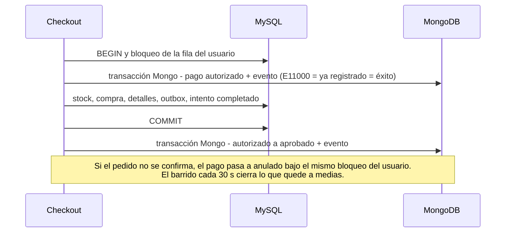
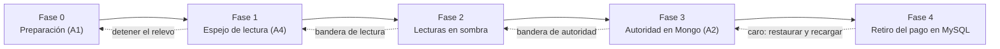

# ADR-005 — ¿Migrar el módulo de pagos a NoSQL? Evaluación frente al modelo relacional

> Fecha: 2026-10-18. Estado: **propuesta**, pendiente de la aceptación del equipo. Evaluación **opcional** del [PRD §5, Entrega 3](PRD.md#5-entregas-y-requerimientos) (puntuación extra). **Decisión propuesta: no migrar la autoridad de los pagos.** MySQL sigue siendo el sistema de registro, se endurece con cuatro cambios concretos (§8) y MongoDB queda reservado como espejo de lectura para cuando aparezca un disparador medible (§9). La decisión se apoya en un ensayo (*spike*) ejecutado el mismo día contra las bases locales del proyecto: 128 verificaciones automáticas, 0 fallidas (§6 y [ADR-005-spike-resultados.json](ADR-005-spike-resultados.json)). Ningún archivo de `backend/src/` cambió: el ensayo vive en `backend/scripts/spike-pagos/` y en un script npm (`spike:pagos`).

> **Nota de alcance.** El PRD (líneas 162 y 180) escribe «NewSQL». El equipo confirmó que es una errata de **NoSQL**: el propio documento plantea la disyuntiva entre el modelo relacional y NoSQL (línea 13: «justificar mantener un componente relacional tiene el mismo peso que justificar una migración a NoSQL»). Este ADR evalúa por eso motores NoSQL, con MongoDB como candidato principal (§2). Si alguien lo leyera literalmente como NewSQL (CockroachDB, TiDB, YugabyteDB), la conclusión no cambiaría: esos motores ofrecen SQL con transacciones distribuidas para escalar horizontalmente o cubrir varias regiones, y ninguno de los disparadores de §9 se cumple. No se probaron en el ensayo.

**Resumen de lo que mostró el ensayo**

1. MySQL ofrece **la misma idempotencia** que MongoDB (clave única, un aprobado por compra) y **la misma flexibilidad** para cargas variables de una pasarela (columna JSON con índice): ninguna de las dos razones clásicas obliga a migrar (E2, E7).
2. Mover el pago a MongoDB obliga a una **saga**. Los diez escenarios de falla ensayados convergen y cumplen cinco invariantes, pero abren ventanas que hoy no existen y se pierde la clave foránea (E2, E5).
3. La saga **más que duplica** la latencia del pedido (2.1× a concurrencia 1) y las lecturas «¿pagó?» pasan a costar 2.5× (E6).
4. Con un único documento caliente, las transacciones de Mongo desperdician trabajo (4447 reintentos para 400 compradores sobre 30 unidades); el bloqueo de fila de MySQL no (E4).
5. El diseño actual tiene **cuatro defectos independientes del motor** (§6.10) que se corrigen sin migrar nada.

## 1. Contexto

### 1.1 Qué es hoy el «módulo de pagos»

| Pieza | Ubicación | Papel |
|---|---|---|
| `metodo_pago` | `schema.prisma:73` | Instrumento guardado: titular, token de la pasarela, últimos 4 dígitos y marca. El número completo nunca se guarda. FK a `usuarios` |
| `pago` | `schema.prisma:150` | Cobro de una compra: `monto` `DECIMAL(10,2)`, `estado` (texto libre), fecha y referencia. Dos FK `RESTRICT`: a `compra` y a `metodo_pago` |
| Escritura | `checkoutService.js:150` y `:322` | `pago.create` dentro de **la** transacción del checkout normal y de la oferta flash: descuento de stock, compra, detalles, pago, `venta_outbox` y vaciado del carrito se confirman juntos |
| Lecturas | `compraService.js:8,20`, `OrderDetailPage.jsx:30`, `OrderHistoryPage.jsx:45` | Historial y detalle de pedidos con su pago |
| Filtros «está pagada» | `resenaService.js:54`, `ventasSyncService.js:156`, `backfillNeo4j.js:88`, `verificarBloqueoCuentas.js:49`, `verificarFraudeNeo4j.js:151` | Una compra cuenta como pagada si existe un pago `aprobado` |
| Protección de borrado | `metodoPagoService.js:34-45` | `P2003` → 409 si el método tiene pagos |
| Registro de la saga | `checkout_intento` (`schema.prisma:197`) y `checkoutIntentoService.js` | UUID durable, respuesta guardada, compensación y barrido (§1.2) |

Los pagos son **simulados**: nacen como `aprobado` con una referencia `TX-<compra>-<instante>` y no mueven dinero (los Términos de Servicio lo dicen). Datos reales de la base de desarrollo el 2026-10-18: **261 pagos**, todos aprobados, suma 102 990.89, del 2026-08-23 al 2026-10-07; toda la base ocupa 0.67 MB. El proyecto corre MySQL 8.4.11 y MongoDB 7.0.40.

### 1.2 Lo que ya está decidido o construido

- **PRD, línea 39:** «Pedidos y pagos: registro transaccional → modelo relacional». Es la decisión de partida que este ADR somete a prueba.
- **[ADR-002](ADR-002-migracion-catalogo-documental.md) (§3.2, §4 y §5):** `inventario`, `compra`, `pago` se dejaron en MySQL a propósito para conservar el checkout atómico. La migración del catálogo no los tocó.
- **[ADR-004](ADR-004-analitica-ventas-cassandra.md):** una compra es «pagada» si existe un pago `aprobado`; no hay cancelaciones ni reembolsos, y añadirlos «exige eventos de ajuste». Cassandra recibe una **proyección** por outbox, no la autoridad.
- **[CHECKOUT-IDEMPOTENCIA](CHECKOUT-IDEMPOTENCIA.md):** `checkout_intento` ya es un registro durable con confirmación atómica en MySQL, gancho previo al trabajo relacional (`checkoutIntentoService.js:129`, hoy usado para reservar cupo en Redis), compensación bajo el bloqueo del usuario (`:137`, `:144`) y un barrido cada 30 s con ventana de 15 min (`:162-180`). Es, de hecho, el andamiaje de una saga.
- **[ENTREGA-3-CONSISTENCIA](ENTREGA-3-CONSISTENCIA.md):** análisis de fallas del checkout entre MySQL, Mongo, Redis, Neo4j y Cassandra. Aquí se amplía a «¿y si el pago también fuera otro almacén?».

### 1.3 Por qué reevaluarlo ahora

1. El PRD lo ofrece como evaluación opcional y pide fundamentarla «con independencia del sentido de la conclusión».
2. El checkout idempotente dejó un registro de saga que antes no existía; el costo de una migración distinta de «reescribir todo» es medible.
3. Una pasarela real (hoy ausente) traería confirmación asíncrona y cargas distintas por medio de pago, los dos argumentos clásicos a favor de un almacén documental. Conviene saber de antemano si MySQL los absorbe.

## 2. Alternativas consideradas

| Alternativa | Aplicación en TiendaYa | Decisión |
|---|---|---|
| **A0** · No cambiar | `pago` y `metodo_pago` siguen exactamente como están | Línea base. Funciona, pero el ensayo encontró cuatro defectos que no dependen del motor (§6.10) |
| **A1** · Mantener y endurecer MySQL | Clave de idempotencia y «un aprobado por compra» en `pago`; orden canónico de bloqueo y reintento ante *deadlock*; `CHECK` sobre `estado` y `monto`; tabla de eventos cuando haya reembolsos | **Seleccionada** |
| **A2** · Autoridad de los pagos en MongoDB (saga) | `pagos` y `pago_eventos` en Mongo; compra e inventario siguen en MySQL; `checkout_intento` hace de registro de la saga | Rechazada hoy. Su escenario completo está en §9 |
| **A3** · Núcleo transaccional en MongoDB | Compra, detalle, pago e inventario en Mongo con transacciones multi-documento | Rechazada: reescribe el checkout, el esquema de Prisma y sus pruebas, y contradice ADR-002 |
| **A4** · MongoDB como espejo | MySQL manda; Mongo recibe `pagos` y `pago_eventos` por outbox (lectura, auditoría) | Aplazada: es la fase 1 del escenario cuando se cumpla un disparador |
| **A5** · Otro NoSQL (DynamoDB, Cassandra, Redis) | DynamoDB: transacciones de hasta 100 acciones en una región; Cassandra: aislamiento solo dentro de una partición; Redis: almacén transitorio del proyecto | Descartada: DynamoDB exige AWS; Cassandra corre aquí con factor de replicación 1 y sin transacciones entre particiones; Redis puede perder el cupo (CHECKOUT-IDEMPOTENCIA, «Límites») |

**Por qué MongoDB es el candidato.** Ya se opera en el proyecto (catálogo, reseñas, historial), su replica set ya admite transacciones (ADR-003), y ofrece justo lo que un NoSQL puede aportar a un pago: `Decimal128`, validación de esquema, índices únicos parciales y transacciones multi-documento. Los demás motores o no cubren la atomicidad entre entidades, o no están disponibles en este entorno.

## 3. Método y criterios

El [PRD §6](PRD.md#6-registro-de-decisiones-arquitectónicas-adr) pide justificar con **consistencia, escalabilidad, patrón de consulta y costo operativo**. Pesos adoptados:

| Criterio | Peso | Por qué ese peso |
|---|---|---|
| Consistencia e integridad | 35 % | Un pago mal registrado es el error más caro del dominio |
| Costo operativo y de cambio | 30 % | Equipo pequeño; quedan entregas por cerrar; cada componente nuevo en la ruta crítica es una falla más |
| Patrón de consulta | 20 % | Los pagos se consultan por pedido y usuario, y se unen con compras en al menos cinco lugares |
| Escalabilidad | 15 % | Hoy son 261 pagos; el volumen no es el problema actual |

Evidencia, con la marca que se usa en las tablas: **[C]** lectura del código del repositorio; **[S]** ensayo propio (§6); **[D]** documentación oficial (§12); **[J]** informes de Jepsen (históricos); **⚠** afirmación no verificada aquí. Ninguna cifra del ensayo se presenta como capacidad de producción (§6.11).

## 4. Contraste técnico

| Criterio | MySQL 8.4.11 (InnoDB) — hoy | MongoDB 7.0.40 | Cassandra 5.0 · DynamoDB | Respaldo |
|---|---|---|---|---|
| Transacción | Multi-fila y multi-tabla con ACID: una confirma stock, compra, detalles, pago, outbox y vaciado del carrito | Atómico por documento. Multi-documento solo en replica set, con `snapshot` + `w:majority` explícitos y vida máxima de 60 s por defecto | Cassandra aísla las actualizaciones de una misma partición y sus lotes no equivalen a una transacción SQL completa. DynamoDB: hasta 100 acciones y 4 MB en una región | [C] `checkoutService.js:78-168` · [S] E3 · [D1] [D2] [D6] [D7] |
| Contención sobre una fila | Cola de bloqueos: las transacciones esperan turno. Un *deadlock* mata a una víctima (error 1213) y la aplicación debe reintentar | Optimista: el conflicto de escritura aborta y se reintenta la transacción **completa** | DynamoDB cancela la transacción en conflicto (`TransactionCanceledException`) y el SDK no la reintenta | [S] E4 · [D2] [D4] [D7] |
| Aislamiento por defecto | `REPEATABLE READ`. Jepsen (8.0.34) lo halló más débil que *snapshot* (actualización perdida, sesgo de escritura); el checkout lo compensa con `SELECT … FOR UPDATE` y `UPDATE` condicional | Jepsen (4.2.6): sin `snapshot` + `w:majority` hay lecturas divergentes y escrituras perdidas; MongoDB atribuyó parte de las anomalías a un error de reintentos, con corrección prevista para 4.2.8 | — | [J1] [J2] · [C] |
| Integridad referencial | Claves foráneas `RESTRICT`: rechaza un pago huérfano (1452) y el borrado de una compra con pagos (1451) | No existe: acepta el pago huérfano y permite borrar la compra. La integridad pasa al código | No existe | [S] E2 |
| Idempotencia | `UNIQUE` sobre la clave del intento; «un aprobado por compra» con columna generada | Índice único; «un aprobado por compra» con índice único parcial | DynamoDB: token de cliente válido 10 min | [S] E2 · [D7] |
| Dinero | `DECIMAL(10,2)` exacto. Ante una escala de más redondea y avisa (12.345 → 12.35, nota 1265) | `Decimal128` (lo que la documentación recomienda; el *double* no sirve para aritmética monetaria). El esquema impone la escala 2. JSON lo serializa como `{"$numberDecimal": …}`: exige mapeo | — | [S] E1 · [D3] |
| Carga variable de la pasarela | Columna `JSON` + columna generada indexada + `CHECK` | Documento + índice parcial + `$jsonSchema` | — | [S] E7 |
| Consultas «¿pagó?» e historial | `JOIN` | Dos consultas: MySQL para la compra, Mongo para el pago | — | [S] E6 R3 vs R4 |
| Escritura durable | Con los valores por defecto, `fsync` por COMMIT (`innodb_flush_log_at_trx_commit=1`, `sync_binlog=1`) | `w:majority` espera el journal; `w:1` no, y puede revertirse | — | [S] E6 · [D5] |
| Escalado | Vertical y réplicas de lectura; sin *sharding* nativo | *Sharding* nativo (no probado: un solo nodo) | Horizontal nativo | ⚠ |
| Operación en el proyecto | Ya operado; Prisma y 11 migraciones | Ya operado (catálogo), pero con un solo nodo, sin autenticación y sin política de respaldos documentada en el repositorio | Cassandra con replicación 1 | [C] |
| PCI | No se guarda el número de tarjeta en ninguno; el alcance depende de si se almacena PAN, no del motor | Ídem | Ídem | [D8]; validar con un QSA |

Nota sobre Jepsen: ambos informes son anteriores a las versiones desplegadas (8.4.11 y 7.0.40). Se usan para una sola lección que sí es vigente: **ningún motor es seguro por defecto**; el diseño tiene que fijar aislamiento y *write concern*. El ensayo lo hace explícito (`snapshot` + `w:majority`), y el checkout actual lo hace con bloqueo de fila y `UPDATE` condicional.

## 5. Qué cambiaría en el checkout si el pago sale de MySQL

### 5.1 Hoy

El pedido, el pago, el descuento de stock, el outbox y el vaciado del carrito se confirman con **un solo COMMIT**. Eso da gratis: ningún pago sin pedido ni pedido sin pago; ningún pago huérfano (FK); una compra con pago `aprobado` implica stock ya descontado. La única ambigüedad —se perdió la respuesta del COMMIT— ya está resuelta por `checkout_intento` bajo el bloqueo del usuario.

### 5.2 Con el pago en MongoDB (A2)

No hay COMMIT compartido, así que cada garantía de arriba pasa a ser un invariante que el código debe sostener. El diseño que se ensayó reutiliza lo existente:



1. `preparar` crea `checkout_intento` pendiente (existente).
2. `confirmar` abre la transacción MySQL y bloquea al usuario (existente).
3. **Gancho nuevo**, donde hoy se reserva el cupo en Redis (`checkoutIntentoService.js:129`): transacción Mongo {insertar `pagos` en estado `autorizado` con `intento_id` único + insertar `pago_eventos`}. Un E11000 significa «ya registrado» y se trata como éxito.
4. Trabajo relacional (existente): stock, compra, detalles, outbox; `checkout_intento → completado` con la respuesta guardada.
5. COMMIT de MySQL.
6. **Post-commit nuevo:** transacción Mongo {`autorizado → aprobado`, evento}.
7. **Compensación** (existente, ampliada): si el pedido no se confirma, y bajo el mismo bloqueo del usuario, `anulado` + evento. El barrido retoma lo pendiente.

Ventanas que esto abre, todas reproducidas en el ensayo (E5) y todas inexistentes en el modelo relacional actual:

| Falla | Qué queda visible mientras dura | Cómo converge | Evidencia |
|---|---|---|---|
| Mongo inalcanzable al autorizar | Nada: el checkout falla cerrado | El intento queda fallido y la compensación pendiente se completa al volver Mongo | S2 |
| MySQL falla después de autorizar (error o stock insuficiente) | Nada: el pago se anula en línea | Inmediata | S3, S4 |
| El proceso muere después de autorizar | Un pago `autorizado` huérfano y un intento pendiente | El barrido, pasado el umbral (15 min en el código actual). Un barrido prematuro **no** anula | S5 |
| Se pierde la respuesta de Mongo | — | Reintento idempotente: E11000 = éxito; un solo pago | S6 |
| Se pierde la respuesta del COMMIT | — | No se anula (el bloqueo lo impide); el reintento devuelve el pedido guardado | S7 |
| Mongo cae justo después del COMMIT | Pedido confirmado con pago aún `autorizado` | El barrido lo aprueba sin duplicar eventos | S8 |

### 5.3 Lecturas

Cinco filtros «está pagada» y dos lecturas de historial pasan de un `JOIN` a dos consultas no atómicas entre sí (la compra en MySQL, el pago en Mongo). El costo medido está en §6.7: la comprobación «¿pagó el producto X?» pasa de 0.49 ms a 1.23 ms (2.5×). La alternativa —una columna `compra.estado_pago` mantenida por la saga— devuelve el `JOIN`, pero crea otra proyección que hay que mantener consistente.

### 5.4 Efectos laterales

- **Se pierde la FK `pago → metodo_pago`:** la protección `P2003` de `metodoPagoService.js:34-45` desaparece. El pago llevaría un *snapshot* (marca y últimos 4), de modo que borrar el método dejaría de ser un problema, pero hay que decidirlo y cambiar el mensaje 409.
- **Los identificadores cambian de tipo:** 11 de los 14 modelos de Prisma usan `Int @default(autoincrement())` como clave primaria. Un pago en Mongo tendría `_id` de tipo `ObjectId`; se conservaría `legacy_id` para la migración y las referencias de los dos componentes de interfaz.
- **`Promise.all` deja de servir dentro de una transacción de Mongo con Mongoose** (§6.4).

## 6. Evidencia: el ensayo (*spike*)

### 6.1 Cómo se ejecutó

```sh
cd backend
npm run spike:pagos -- --salida=../IA/ADR-005-spike-resultados.json
```

Código en `backend/scripts/spike-pagos/` (`index.js` y un archivo por experimento). Trabaja **solo** en la base Mongo `tiendaya_poc_pagos` y el esquema MySQL `prisma_migrate_shadow_db_poc` (el patrón `prisma_migrate_shadow_db_%` ya está concedido al usuario de la aplicación en `docker/mysql-init/01-grant-shadow-db.sql`, así que no hizo falta ningún privilegio nuevo); los crea y los borra. De `tiendaya` únicamente **lee** `pago`, `compra` y `metodo_pago` con una sesión `READ ONLY` (E8). No modifica `backend/src/` y no detiene contenedores. Se ejecutó con el backend apagado; la corrida completa tarda unos cinco minutos.

Entorno de la corrida registrada:

| Dato | Valor |
|---|---|
| Servidores | MySQL 8.4.11 (`innodb_flush_log_at_trx_commit=1`, `sync_binlog=1`, aislamiento REPEATABLE-READ, *buffer pool* 128 MB) · MongoDB 7.0.40 (replica set de 1 nodo, `writeConcernMajorityJournalDefault=true`) |
| Clientes | Node v24.14.1, driver `mongodb` 7.5.0, driver `mariadb` 3.4.5 (sin Prisma ni Mongoose, salvo la comprobación de E3) |
| Equipo | 11th Gen Intel(R) Core(TM) i7-11800H @ 2.30GHz x16 · 16 GB · Windows_NT 10.0.26300 · Docker Desktop (WSL2) con los seis contenedores del proyecto activos |
| Duración | 319 s en total |

### 6.2 E1 — Dinero (8/8 verificaciones)

**Σ de 100.000 montos**

| Representación | Suma | Diferencia vs exacto |
|---|---|---|
| Enteros en centavos (referencia exacta) | 4999516.75 | 0 |
| JavaScript Number acumulado | 4999516.749999998 | -1.86e-9 |
| Mongo `$sum` sobre double | 4999516.75 | 0 |
| Mongo `$sum` sobre Decimal128 | 4999516.75 | 0 |
| MySQL `SUM(DECIMAL(10,2))` | 4999516.75 | 0 |

- `Decimal128` conserva `19.99` exacto; el validador (`$jsonSchema` + `$expr` con `$round`) rechaza un monto *double*, un monto *string*, una escala de 3 decimales y un estado fuera del enum (código 121). `multipleOf: 0.01` también impone la escala.
- La suma de 100 000 montos es exacta en `Decimal128`, en `DECIMAL(10,2)` y —para estos datos— en `$sum` sobre *double*; el acumulado en JavaScript sí se desvía. La lección no es que el *double* de Mongo falle, sino que **el esquema es la defensa**: sin él, un `19.99` entra igual que un `Decimal128`.
- MySQL **redondea** 12.345 a 12.35 con una nota (1265) en vez de rechazarlo; fuera de rango rechaza (1264).
- La API hoy entrega `"19.99"` (string de Prisma); `Decimal128` sin mapeo entregaría `{"$numberDecimal":"19.99"}`.

### 6.3 E2 — Idempotencia e integridad referencial (16/16)

**Idempotencia: Mongo vs MySQL**

| Mecanismo | MongoDB 7.0 | MySQL 8.4 |
|---|---|---|
| Clave de idempotencia única, 50 escrituras simultáneas | 1 éxito por ronda (980 E11000) | 1 éxito por ronda (980 ER_DUP_ENTRY) |
| "Un aprobado por compra" | índice único parcial | UNIQUE sobre columna generada |
| Anulado/reembolso de la misma compra | admitido | admitido |
| Pago con compra inexistente / borrar una compra con pagos | se acepta / se permite (sin FK) | rechazado 1452 / rechazado 1451 (FK RESTRICT) |
| Requiere cambio de esquema hoy | colección nueva | ALTER TABLE pago (columna + 2 UNIQUE) |

Con 50 escrituras simultáneas de la misma clave, **ambos motores dejan exactamente una** (20 rondas: 20 éxitos, 980 duplicados). Un reintento tras perder la respuesta del servidor choca con la clave única y se trata como éxito. Es decir: la idempotencia que A2 compraría con un índice único de Mongo **también la da MySQL** con una columna y dos `UNIQUE`. En cambio, la integridad referencial sí es una diferencia estructural: MySQL rechaza el pago huérfano; Mongo lo acepta.

### 6.4 E3 — Transacciones y aislamiento (4/4)

- Una falla dentro de una transacción de Mongo deshace pago, evento y descuento de stock a la vez; un lector externo no ve nada antes del COMMIT.
- Documento caliente: 50 transacciones simultáneas sobre un contador terminaron con el valor exacto, a costa de **248 ejecuciones del callback** (198 reintentos por conflicto de escritura) en 296 ms.
- **Mongoose:** 30 de 30 transacciones fallaron al ejecutar 5 `create()` en `Promise.all` con la misma sesión (`MongoServerError: Only servers in a sharded cluster can start a new transaction at the active transaction number`); las mismas operaciones en secuencia nunca fallaron. La documentación de Mongoose lo califica de comportamiento indefinido [D9]. El checkout usa `Promise.all` contra Mongo (`checkoutService.js:184`), hoy fuera de una transacción; dentro de una habría que serializarlo.

### 6.5 E4 — Contención sobre el stock (17/17)

**Oferta flash: compradores simultáneos sobre pocas unidades**

| Variante | Compradores/unidades | Compradas/agotadas/errores | Stock final | Pagos | Reintentos de tx | Tiempo total (ms) | p50 (ms) | p95 (ms) | p99 (ms) |
|---|---|---|---|---|---|---|---|---|---|
| MySQL (actual) | 100/30 | 30/70/0 | 0 | 30 | — | 399 | 376.3 | 392.4 | 394.2 |
| Mongo sin transacción | 100/30 | 30/70/0 | 0 | 30 | — | 61 | 33.0 | 60.1 | 60.3 |
| Mongo con transacción | 100/30 | 30/70/0 | 0 | 30 | 776 | 599 | 417.8 | 504.3 | 534.5 |
| MySQL (actual) | 400/30 | 30/370/0 | 0 | 30 | — | 563 | 474.1 | 549.4 | 555.5 |
| Mongo sin transacción | 400/30 | 30/370/0 | 0 | 30 | — | 108 | 61.5 | 100.6 | 107.3 |
| Mongo con transacción | 400/30 | 30/370/0 | 0 | 30 | 4447 | 2110 | 1771.5 | 1980.4 | 2061.3 |

Todas las variantes venden **exactamente** las unidades disponibles (sin sobreventa, stock final 0). Lo que cambia es el comportamiento:

- **MySQL (el diseño actual):** los compradores hacen cola por el bloqueo de la fila. Con 100 compradores sobre 30 unidades tarda 399 ms y con 400, 563 ms; la latencia p50 (376 ms) casi iguala el total porque los 70 que no consiguen unidad esperan a que se confirmen las 30 compras anteriores. Es consistente con el costo de un COMMIT durable aquí (§6.7): 30 confirmaciones en fila, una tras otra.
- **Mongo sin transacción:** el más rápido (61 ms), porque el descuento atómico de un documento no espera a nadie. Pero descuento, compra y pago son tres escrituras independientes: una falla entre ellas deja stock descontado sin pedido. No es una variante comparable en seguridad.
- **Mongo con transacción:** correcta, pero con 776 reintentos para 100 compradores y **4447** para 400 (2110 ms en total, más que MySQL). Con un único documento caliente, el control optimista desperdicia trabajo; el bloqueo de fila de InnoDB no.

**Orden de bloqueo entre dos productos**

| Caso | Tx | Terminaron | Deadlocks (1213) | Reintentos | Otros errores | Tiempo (ms) |
|---|---|---|---|---|---|---|
| MySQL, orden opuesto, pausa 15 ms, sin reintento | 60 | 30 | 30 | 0 | 0 | 1050 |
| MySQL, orden opuesto, pausa 15 ms, con reintento en 1213 | 60 | 60 | 0 | 71 | 0 | 2392 |
| MySQL, orden canónico (id ascendente), pausa 15 ms | 60 | 60 | 0 | 0 | 0 | 2101 |
| MySQL, orden opuesto, SIN pausa (ventana real) | 300 | 150 | 150 | 0 | 0 | 1943 |
| Mongo, orden opuesto, pausa 15 ms, withTransaction | 60 | 60 | 0 | 1016 | 0 | 4501 |

Hallazgo independiente del motor: si dos transacciones tocan los mismos dos productos en **orden opuesto**, MySQL mata a una víctima por *deadlock* (error 1213) en torno a la mitad de las transacciones (30 de 60 con pausa; 150 de 300 sin ella), y todas terminan si se reintenta la transacción completa o si se bloquea en orden canónico. Hoy el código itera `items` en el orden recibido (`checkoutService.js:98`), no ordena y no reintenta. La interfaz envía el carrito ordenado por `id_producto` (`cartService.js:53`), así que el riesgo práctico es bajo; pero el servidor no lo garantiza y la documentación de MySQL lo pide explícitamente [D4].

**Visto desde el stack real de la aplicación (E9, 5/5).** Con Prisma y su adaptador MariaDB el mismo deadlock llega al código del checkout como `PrismaClientKnownRequestError` con código `P2034` (el mensaje de Prisma pide reintentar la transacción). La transacción víctima se revierte entera y, reintentando la transacción completa ante ese código, las 40 transacciones de orden opuesto terminan (46 reintentos) con el descuento exacto en los dos productos.

**Error que ve el código del checkout**

| Clase | Código | Mensaje |
|---|---|---|
| PrismaClientKnownRequestError | P2034 | Transaction failed due to a write conflict or a deadlock. Please retry your transaction |

### 6.6 E5 — Saga con fallas inyectadas (17/17)

**Escenarios**

| # | Escenario | Falla inyectada | Estado inmediato | Tras el barrido | OK |
|---|---|---|---|---|---|
| S0 | Sin falla (referencia) | — | intento completado; compras 1; pago aprobado; eventos autorizado→aprobado | — | ✔ |
| S1 | Doble clic: 20 confirmaciones simultáneas, mismo intento | — | 20/20 respondieron, 19 con el resultado guardado; intento completado; compras 1; pago aprobado; eventos autorizado→aprobado | — | ✔ |
| S2 | Corte de red hacia Mongo antes de autorizar el pago | proxy cortado; serverSelectionTimeoutMS=1500, 2 intentos | MongoServerSelectionError tras 4.6 s (incluye el intento de compensación); intento fallido; compras 0; pago —; eventos — | intento fallido+compensado; compras 0; pago —; eventos — | ✔ |
| S3 | Falla de MySQL tras autorizar el pago en Mongo | error antes del COMMIT | intento fallido+compensado; compras 0; pago anulado; eventos autorizado→anulado | — | ✔ |
| S4 | Stock insuficiente (rechazo de negocio) tras autorizar | UPDATE condicional afecta 0 filas | intento fallido+compensado; compras 0; pago anulado; eventos autorizado→anulado | — | ✔ |
| S5 | El proceso muere entre la autorización en Mongo y el COMMIT | excepción sin compensación en línea | intento pendiente; compras 0; pago autorizado; eventos autorizado; un barrido prematuro (umbral 60 s) no cambia nada | intento fallido+compensado; compras 0; pago anulado; eventos autorizado→anulado | ✔ |
| S6 | Mongo escribió el pago pero la respuesta se perdió | excepción de red tras el insert | intento completado; compras 1; pago aprobado; eventos autorizado→aprobado | — | ✔ |
| S7 | COMMIT de MySQL aplicado pero la respuesta se perdió | excepción tras el COMMIT | intento completado; compras 1; pago aprobado; eventos autorizado→aprobado | reintento: pedido 4 reutilizado, sin escrituras nuevas | ✔ |
| S8 | Pedido confirmado pero Mongo no puede aprobar el pago en ese instante | excepción al aprobar | intento completado; compras 1; pago autorizado; eventos autorizado | intento completado; compras 1; pago aprobado; eventos autorizado→aprobado | ✔ |
| S9 | Variante outbox (Mongo como proyección): Mongo caído y relevo que cae tras escribir | Mongo inalcanzable; caída antes de marcar procesado | fila pendiente (intentos=1); pedido ya confirmado | documentos=1, procesada=true | ✔ |

Los diez escenarios convergen y, al final, se cumplen los cinco invariantes: **I1** cada pedido tiene exactamente un pago aprobado; **I2** no hay pagos aprobados sin pedido; **I3** no queda ningún pago `autorizado` tras el barrido; **I4** el stock descontado equivale a los pedidos confirmados; **I5** la suma de totales de pedidos es igual a la de montos de pagos aprobados.

S2: con Mongo inalcanzable el checkout tardó 4.6 s en fallar (serverSelectionTimeoutMS=1500, 2 intentos, más un intento de compensación). El valor por defecto del driver es 30 000 ms: sin configurarlo, el usuario esperaría con su fila bloqueada hasta que venza la transacción interactiva de Prisma (15 s en checkoutIntentoService.js). Sin esperar a que el monitor del driver marque el servidor como caído, el mismo corte puede fallar al instante con `MongoNetworkError` (0.3 s en una corrida previa); el ensayo fija el caso lento, que es el peor.

Es un **modelo** de la saga (no el código de producción), con la misma forma que el checkout idempotente: registro de intentos en MySQL, bloqueo del usuario, E11000 como éxito, barrido con umbral. La falla de red de S2 y S9 la produce un proxy TCP propio que destruye las conexiones del driver real; no es una excepción fabricada.

### 6.7 E6 — Rendimiento (36/36)

Diseño: durabilidad equivalente (MySQL con sus valores por defecto frente a `w:majority`, que con *journaling* espera el disco; `w:1` sin journal se incluye solo como referencia), calentamiento descartado, **tres rondas intercaladas** entre cargas y mediana con rango mín–máx, 2 000 productos repartidos para no medir contención (eso es E4).

**Leyenda de las cargas de escritura**

| # | Carga | Qué hace | Escribe |
|---|---|---|---|
| A | MySQL: INSERT de un pago (autocommit) | Una fila en una tabla con la forma de `pago`, sin FK, con fsync por COMMIT. | 1 fila, 1 commit |
| B | Mongo: insertOne con w:1 | Un documento de pago; se confirma en memoria sin esperar el journal (puede perderse ante una caída). | 1 doc |
| C | Mongo: insertOne con w:1, j:true | Un documento de pago; se confirma tras escribir el journal en disco. | 1 doc, 1 commit |
| D | Mongo: insertOne con w:majority | Un documento de pago; w:majority en un replica set de un nodo equivale a esperar el journal (writeConcernMajorityJournalDefault=true). | 1 doc, 1 commit |
| E | Pedido como hoy (todo en MySQL) | Una transacción: UPDATE condicional de stock + INSERT compra + INSERT pago, con las FK reales. | 3 filas, 1 commit |
| F | Pedido + fila outbox hacia Mongo (Opción C) | Igual que E más una fila de outbox en la misma transacción; el relevo a Mongo ocurre fuera de la ruta crítica. | 4 filas, 1 commit |
| G | Saga: pago en Mongo, pedido en MySQL (Opción B) | Transacción Mongo {pago autorizado, evento} dentro de la transacción MySQL {stock, compra, intento}, y luego transacción Mongo {aprobar pago, evento}. | 4 docs + 3 filas, 3 commits |
| H | Todo en Mongo, una transacción (Opción A3) | Transacción multi-documento: descuento de stock + compra + pago + evento, con snapshot y w:majority. | 4 docs, 1 commit |

**Escrituras — concurrencia 1 (300 operaciones por celda × 3 rondas)**

| # | Carga | ops/s mediana [mín–máx] | p50 ms | p95 ms | p99 ms |
|---|---|---|---|---|---|
| A | MySQL: INSERT de un pago (autocommit) | 95 [85–97] | 9.64 | 13.27 | 18.16 |
| B | Mongo: insertOne con w:1 | 1547 [1396–1682] | 0.60 | 0.76 | 0.96 |
| C | Mongo: insertOne con w:1, j:true | 214 [203–215] | 4.06 | 7.20 | 8.39 |
| D | Mongo: insertOne con w:majority | 211 [200–213] | 4.14 | 7.31 | 8.34 |
| E | Pedido como hoy (todo en MySQL) | 76 [74–78] | 12.77 | 16.40 | 22.41 |
| F | Pedido + fila outbox hacia Mongo (Opción C) | 76 [75–78] | 12.54 | 15.86 | 22.91 |
| G | Saga: pago en Mongo, pedido en MySQL (Opción B) | 37 [36–37] | 26.88 | 33.53 | 38.24 |
| H | Todo en Mongo, una transacción (Opción A3) | 135 [129–138] | 6.87 | 10.19 | 13.40 |

**Escrituras — concurrencia 8 (800 operaciones por celda × 3 rondas)**

| # | Carga | ops/s mediana [mín–máx] | p50 ms | p95 ms | p99 ms |
|---|---|---|---|---|---|
| A | MySQL: INSERT de un pago (autocommit) | 282 [275–293] | 26.16 | 38.66 | 47.04 |
| B | Mongo: insertOne con w:1 | 6602 [6048–7043] | 1.11 | 1.60 | 2.03 |
| C | Mongo: insertOne con w:1, j:true | 810 [793–832] | 9.09 | 12.49 | 14.29 |
| D | Mongo: insertOne con w:majority | 791 [717–817] | 9.62 | 12.90 | 13.50 |
| E | Pedido como hoy (todo en MySQL) | 271 [266–271] | 26.51 | 41.41 | 57.70 |
| F | Pedido + fila outbox hacia Mongo (Opción C) | 264 [255–275] | 26.98 | 44.93 | 66.24 |
| G | Saga: pago en Mongo, pedido en MySQL (Opción B) | 101 [99–101] | 78.21 | 115.26 | 128.00 |
| H | Todo en Mongo, una transacción (Opción A3) | 643 [591–643] | 12.05 | 16.45 | 18.19 |

**Escrituras — concurrencia 32 (3200 operaciones por celda × 3 rondas)**

| # | Carga | ops/s mediana [mín–máx] | p50 ms | p95 ms | p99 ms |
|---|---|---|---|---|---|
| A | MySQL: INSERT de un pago (autocommit) | 971 [949–1021] | 31.97 | 47.81 | 64.35 |
| B | Mongo: insertOne con w:1 | 5718 [5717–7167] | 4.83 | 8.18 | 8.94 |
| C | Mongo: insertOne con w:1, j:true | 2525 [2506–2533] | 12.51 | 15.37 | 18.16 |
| D | Mongo: insertOne con w:majority | 2539 [2417–2575] | 12.47 | 15.99 | 18.66 |
| E | Pedido como hoy (todo en MySQL) | 795 [702–863] | 38.94 | 54.27 | 94.78 |
| F | Pedido + fila outbox hacia Mongo (Opción C) | 709 [652–787] | 39.20 | 70.85 | 114.75 |
| G | Saga: pago en Mongo, pedido en MySQL (Opción B) | 267 [252–269] | 117.89 | 185.60 | 217.34 |
| H | Todo en Mongo, una transacción (Opción A3) | 1169 [1123–1184] | 27.93 | 32.02 | 37.41 |

**Lecturas sobre 100.000 pagos — concurrencia 1**

| # | Carga | ops/s mediana [mín–máx] | p50 ms | p95 ms | p99 ms |
|---|---|---|---|---|---|
| R1 | MySQL: pago de una compra (por id_compra) | 2415 [2337–2436] | 0.40 | 0.61 | 0.72 |
| R2 | Mongo: pago de una compra (por compra_id) | 1730 [1698–1745] | 0.56 | 0.69 | 0.81 |
| R3 | "¿Pagó el producto X?" MySQL: JOIN compra⨝detalle⨝pago | 1923 [1820–1945] | 0.49 | 0.74 | 0.89 |
| R4 | "¿Pagó el producto X?" pago en Mongo: consulta MySQL + consulta Mongo (2 viajes) | 794 [779–799] | 1.23 | 1.51 | 1.94 |
| R5 | MySQL: últimos 20 pagos de un usuario (JOIN compra⨝pago) | 1896 [1881–1911] | 0.52 | 0.60 | 0.68 |
| R6 | Mongo: últimos 20 pagos de un usuario (usuario_id denormalizado) | 1524 [1456–1576] | 0.64 | 0.79 | 0.90 |

**Lecturas sobre 100.000 pagos — concurrencia 16**

| # | Carga | ops/s mediana [mín–máx] | p50 ms | p95 ms | p99 ms |
|---|---|---|---|---|---|
| R1 | MySQL: pago de una compra (por id_compra) | 18362 [16330–18552] | 0.85 | 1.07 | 1.17 |
| R2 | Mongo: pago de una compra (por compra_id) | 6920 [6404–7462] | 2.19 | 2.80 | 4.20 |
| R3 | "¿Pagó el producto X?" MySQL: JOIN compra⨝detalle⨝pago | 15177 [12090–15853] | 1.03 | 1.28 | 1.41 |
| R4 | "¿Pagó el producto X?" pago en Mongo: consulta MySQL + consulta Mongo (2 viajes) | 4487 [3944–4631] | 3.47 | 4.49 | 5.54 |
| R5 | MySQL: últimos 20 pagos de un usuario (JOIN compra⨝pago) | 13265 [11883–13480] | 1.17 | 1.47 | 1.74 |
| R6 | Mongo: últimos 20 pagos de un usuario (usuario_id denormalizado) | 4967 [4897–5019] | 2.94 | 4.88 | 8.18 |

Lectura de los números:

- **Un pago aislado** cuesta 9.64 ms en MySQL (autocommit con `fsync`) y 4.14 ms en Mongo con `w:majority` (`w:1` sin journal: 0.60 ms). A concurrencia 32: 971 frente a 2539 ops/s.
- **El pedido completo** como hoy (E) tarda 12.8 ms p50. Añadir la fila de outbox hacia Mongo (F) no lo mueve: 12.5 ms. La **saga** (G) lo lleva a 26.9 ms (2.1×) porque hace tres confirmaciones durables en lugar de una. Hacerlo **todo en Mongo** en una transacción (H) es más rápido en este entorno: 6.87 ms (0.54× el de hoy).
- **A concurrencia 32** el p50 es 38.9 ms (hoy), 117.9 ms (saga) y 27.9 ms (todo en Mongo); el rendimiento, 795, 267 y 1169 ops/s.
- **Lecturas** con 100 000 pagos: la búsqueda por compra cuesta 0.40 ms en MySQL y 0.56 ms en Mongo; «¿pagó el producto X?» pasa de 0.49 ms (`JOIN`) a 1.23 ms (dos consultas); a concurrencia 16, de 15177 a 4487 ops/s.

Cómo interpretarlo con honestidad: Mongo gana en escritura durable **en este equipo**, y la razón verosímil (no demostrada aquí) es que MySQL sincroniza dos registros por COMMIT (redo y binlog) frente a un journal en Mongo; en un servidor con disco de baja latencia la diferencia se achica. Esa ventaja no se traduce en la mejor opción para pagos: la única variante que conserva el pedido en MySQL —la saga— es la **más lenta** de las tres, y la que es más rápida (todo en Mongo) es la que pierde la FK, reescribe el checkout y se degrada con contención (§6.5).

### 6.8 E7 — Flexibilidad del payload (11/11)

**Mongo vs MySQL 8.4 con JSON**

| Capacidad | MongoDB 7.0 | MySQL 8.4 |
|---|---|---|
| Tres formas de payload en una misma tabla/colección | sí | sí (columna JSON) |
| Consulta por un campo de la parte variable | índice parcial → IXSCAN | columna generada + índice → ref |
| Campo variable sin índice | COLLSCAN | recorrido completo (ALL) |
| Validación de los campos obligatorios | $jsonSchema (121) | CHECK constraint (3819) |
| Costo de añadir un campo nuevo consultable | crear índice | ALTER TABLE + columna generada + índice |

Una pasarela real devolvería cargas distintas según el medio de pago (tarjeta, billetera, transferencia). MySQL 8.4 las admite en una columna `JSON`, consulta un campo de la parte variable con una columna generada indexada (el plan usa el índice) y valida los campos obligatorios con un `CHECK`. Mongo hace lo mismo con un índice parcial y `$jsonSchema`. En ambos, un campo del payload **sin** índice recorre todo. La flexibilidad de esquema, por sí sola, no justifica migrar.

### 6.9 E8 — Migración de los 261 pagos reales (14/14)

**Cargas y conciliaciones**

| Paso | Resultado |
|---|---|
| Carga inicial | 261 insertados, 0 modificados (79 ms) |
| Conciliación | conteo 261/261, Σ 102990.89, huella igual |
| Segunda carga | 0 insertados, 0 modificados |
| Monto alterado en destino | conteo igual; Σ 112910.05 (esperada 102990.89); fila 131 identificada |
| Documento borrado | conteo 260/261 |
| Reparación (tercera carga) | 1 insertado, 1 modificado; huella igual |

Fuente: 261 pagos (estados: aprobado 261), Σ monto = 102990.89, del 2026-08-23 al 2026-10-07.

Tamaño: tabla MySQL `pago` ≈ 80.0 KB (datos + índices) vs colección Mongo ≈ 4.0 KB de almacenamiento + 20.0 KB de índices (318 B por documento).

El ensayo de la fase 1 cargó los pagos reales a una colección temporal con *upsert* por `legacy_id`, y comprobó: conteo, suma exacta y huella SHA-256 fila a fila iguales; una segunda carga sin cambios (0 insertados, 0 modificados); una divergencia silenciosa de un monto que el **conteo no ve** pero la suma y la huella sí, y que la comparación fila a fila localiza; y que reejecutar la carga repara el borrado y la alteración. Los datos reales cumplen el índice único parcial «un aprobado por compra». El *snapshot* del método de pago copia marca y últimos 4 dígitos, **no** el titular ni el token. La diferencia de tamaño es irrelevante a esta escala (páginas de 16 KB en InnoDB).

### 6.10 Hallazgos que no dependen del motor

Cuatro defectos del diseño actual que el ensayo hizo visibles y que A1 corrige sin migrar nada:

1. **`pago` no tiene clave de idempotencia ni restricción de unicidad por compra.** Hoy dos filas `aprobado` para la misma compra son posibles a nivel de base de datos; solo `checkout_intento` lo evita en la aplicación. Mecanismo comprobado en E2.
2. **Sin orden canónico de bloqueo ni reintento ante *deadlock*** (E4, E9), mientras la documentación de MySQL pide ambas cosas [D4].
3. **`estado` es texto libre** (`schema.prisma:155`), sin enumeración ni `CHECK`; con reembolsos y una pasarela real hacen falta estados cerrados. El mecanismo (`CHECK`, error 3819) quedó comprobado en E7.
4. **El total se calcula con `Number`** (`checkoutService.js:115-116`). Es inofensivo mientras `DECIMAL(10,2)` redondee, pero una conciliación exacta con una pasarela real pide aritmética decimal o céntimos enteros (E1 muestra la deriva del acumulado en coma flotante).

### 6.11 Lo que el ensayo no prueba

| Límite | Consecuencia |
|---|---|
| Un portátil con Docker Desktop (WSL2); MySQL y Mongo comparten disco, reloj y `fsync` | Las **razones** entre filas son informativas; las cifras absolutas no son capacidad de producción. El costo del `fsync` es alto y variable aquí |
| Replica set de **un** nodo | `w:majority` equivale a esperar el journal local: no mide la ida y vuelta a secundarios ni muestra elecciones ni reversión de escrituras `w:1` |
| Datos pequeños (261 pagos reales; 100 000 sintéticos solo para lecturas) y todo cabe en memoria | No dice nada de volúmenes que superen la RAM |
| Sin red, TLS ni autenticación (contenedores de desarrollo) | Una instalación real añade latencia y configuración |
| Clientes nativos (`mongodb`, `mariadb`), no Prisma ni Mongoose | Los ORM añaden costo a ambos lados; solo E3 usa Mongoose |
| MySQL sin réplica | La alta disponibilidad (semisíncrona o *group replication*) añadiría costo al COMMIT; no se midió |
| Fallas inyectadas en proceso y por proxy TCP, no cortes de energía ni `kill -9` | La durabilidad ante caídas se apoya en la documentación y en Jepsen, no en este ensayo |
| La saga es un modelo, no el código de producción | El checkout real tiene más caminos (oferta flash, versión de carrito, sesiones) |
| Tres rondas por celda, sin pruebas de significancia | Los rangos mín–máx muestran la dispersión; no hay intervalos de confianza |

## 7. Matriz ponderada

Puntajes de 1 a 5 (mayor es mejor), cada uno anclado a la evidencia de arriba:

| Alternativa | Consistencia (35 %) | Costo (30 %) | Consulta (20 %) | Escalabilidad (15 %) | **Total** |
|---|---|---|---|---|---|
| A0 · No cambiar | 4 | 5 | 4 | 3 | **4.15** |
| **A1 · Mantener y endurecer MySQL** | 5 | 4 | 4 | 3 | **4.20** |
| A2 · Pagos en Mongo (saga) | 3 | 2 | 3 | 3 | **2.70** |
| A3 · Núcleo en Mongo | 3 | 1 | 3 | 4 | **2.55** |
| A4 · Mongo como espejo | 5 | 3 | 4 | 3 | **3.90** |
| A5 · Otro NoSQL | 2 | 1 | 2 | 5 | **2.15** |

Justificación de los puntajes más discutibles:

- **A1 = 5 en consistencia, A0 = 4:** la diferencia son los defectos de §6.10 (idempotencia solo en la aplicación, sin reintento de *deadlock*).
- **A2 = 3:** hay ventanas reales (S5, S8) que convergen, pero la FK se pierde y la integridad pasa al código. **Escalabilidad 3:** los pagos escalarían, pero el pedido sigue limitado por el COMMIT de MySQL.
- **A3 = 4 en escalabilidad:** el único con ventaja medida (H frente a E), pero se degrada con contención (§6.5).
- **A4 = 3 en costo:** una fila más en el COMMIT (p50 de 12.5 ms frente a 12.8 ms: sin diferencia apreciable) y un trabajador nuevo, con Mongo ya operado.

Sensibilidad (los otros pesos se reparten en proporción):

| Escenario de pesos | Mejor | Segundo | A2 / A3 |
|---|---|---|---|
| Base (35/30/20/15) | A1 4.20 | A0 4.15 | 2.70 / 2.55 |
| Pesos iguales | A0 y A1 4.00 | A4 3.75 | 2.75 / 2.75 |
| Escalabilidad al 40 % | A1 3.85 | A0 3.80 | 2.80 / 3.00 |
| Sin peso al costo | A1 y A4 4.15 | A0 3.70 | 3.00 / 3.30 |

A3 solo superaría a A1 si la escalabilidad pesara más del 68 % del total; A2 no lo supera con ningún peso, porque no mejora la escalabilidad frente a A1 (el pedido sigue en MySQL). La matriz es un juicio anclado en evidencia, no una medición: se presenta con su sensibilidad justamente para que se pueda discutir.

## 8. Decisión (propuesta)

**Se mantiene MySQL como sistema de registro de pedidos y pagos (A1). No se migra la autoridad de los pagos a NoSQL.** Razones, en el orden del PRD:

1. **Consistencia.** Es el dominio donde un COMMIT único vale más. Mover el pago crea un invariante entre dos almacenes que el código debe sostener; el ensayo prueba que se puede sostener (E5), pero con ventanas que hoy no existen y sin la FK (E2).
2. **Patrón de consulta.** Los pagos se unen con compras y detalles; el `JOIN` es 2.5 veces más rápido que el equivalente en dos consultas (p50, concurrencia 1) y mantiene la atomicidad de la lectura (§6.7).
3. **Escalabilidad.** 261 pagos y una base de 0.67 MB. Aun forzando 400 compradores sobre 30 unidades, MySQL se comporta de forma predecible y mejor que las transacciones de Mongo sobre un documento caliente (§6.5). El único límite observado es la latencia de un COMMIT durable (≈ 12 ms aquí), que depende del entorno.
4. **Costo operativo.** Un tercer almacén en la ruta crítica añade modos de falla (S2: el valor por defecto de `serverSelectionTimeoutMS` es 30 000 ms [D10], así que sin configurarlo el usuario esperaría con su fila bloqueada hasta que venza la transacción interactiva de Prisma, 15 s) y entre 34 y 50 horas adicionales al endurecimiento (§9.7) para obtener lo que MySQL también da: idempotencia (E2) y carga variable (E7).

**Lo que MongoDB sí aportaría, y por qué hoy no alcanza** (el PRD pide el mismo rigor para quedarse que para irse):

| Aporte | Evidencia | Por qué no basta hoy |
|---|---|---|
| Escritura durable más barata | Un pago aislado cuesta 4.14 ms con `w:majority` frente a 9.64 ms en MySQL; a concurrencia 32, 2539 frente a 971 ops/s (E6) | Depende del `fsync` de este entorno; el pedido sigue pagando su COMMIT en MySQL y la saga lo encarece (2.1×) |
| Registro natural de eventos del pago | `pago_eventos` con estados autorizado, aprobado y anulado (E5) | MySQL puede llevar el mismo registro en una tabla de solo inserción (cuarto cambio de abajo) |
| Carga variable de la pasarela | Documento + índice parcial + `$jsonSchema` (E7) | MySQL 8.4 la cubre con JSON, columna generada indexada y `CHECK` (E7) |
| Idempotencia con índice único | E11000 como éxito (E2) | MySQL da lo mismo con `UNIQUE` (E2) |
| Escalado horizontal | ⚠ no probado (un solo nodo) | 261 pagos; no hay disparador T4 |

**Trabajo derivado de la decisión** (propuesto, no implementado por este ADR; ≈ 6–10 h los tres primeros):

1. Migración aditiva: `pago.intento_id` + `UNIQUE`, y «un aprobado por compra» con una columna generada + `UNIQUE` (mecanismo de E2).
2. Ordenar `items` por `productoId` antes de bloquear y reintentar la transacción ante *deadlock* (MySQL 1213, que Prisma entrega como `PrismaClientKnownRequestError` con código `P2034`; E9) en `checkout` y `checkoutOferta`.
3. `CHECK` sobre `estado` (enumeración cerrada) y `monto > 0`.
4. Cuando existan reembolsos o una pasarela real: tabla `pago_evento` de solo inserción (el «ajuste por evento» que ya anticipa ADR-004).

**Qué se rechaza y por qué:** A3, porque reescribe el checkout y se degrada bajo contención; A5, porque ningún otro motor está disponible o cubre la atomicidad entre entidades; A2, porque hoy no hay nada que la justifique frente a A1 (§7, §9.1).

## 9. Escenario de migración

Este es el camino si el equipo decide cambiar de parecer. No se ejecuta ahora. Cada fase se puede detener, tiene criterio de salida medible y una vía de retorno; solo la última es cara de deshacer.



### 9.1 Disparadores

| # | Disparador | Umbral propuesto (a acordar) | Primer paso |
|---|---|---|---|
| T1 | Pasarela real con confirmación asíncrona (*webhooks*) y más estados | Cualquier integración que devuelva «pendiente» | A1 + `pago_evento`; fase 1 si los eventos crecen |
| T2 | Libro de auditoría inmutable de cada pago y reembolso | Requisito contable o legal | `pago_evento` de solo inserción, en MySQL o en Mongo (fase 1) |
| T3 | Cargas heterogéneas de la pasarela | Más de 5 formas distintas o más de 3 campos consultados dentro del payload | JSON + columna generada (E7) hasta que duela |
| T4 | Saturación medida de la escritura | p95 del checkout por encima del objetivo acordado, con el cuello en el COMMIT de MySQL **tras** escalarlo y afinarlo | Fase 1; fase 3 solo si persiste |
| T5 | Escrituras en varias regiones | Requisito | Evaluar también SQL distribuido |
| T6 | Servicio gestionado con cifrado de campos validado para PCI | Decisión de adoptarlo | Fase 1 sobre ese servicio |

### 9.2 Fase 0 — Preparación (es A1; vale por sí sola)

- **Cambios:** módulo `pagoService` que encapsule la creación y las lecturas de pago (hoy repartidas en 2 escrituras, 2 lecturas, 1 filtro de reseñas, 1 de ventas y 3 scripts); la migración de idempotencia y el *deadlock* de §8; un script `reconciliarPagos` con la lógica de E8.
- **Preparar Mongo para datos financieros:** autenticación y roles (el servicio de pagos solo inserta; otro rol concilia), `$jsonSchema` de E1, índices de E2, *write concern* `majority` y lectura `snapshot` fijados explícitamente, `serverSelectionTimeoutMS` y `socketTimeoutMS` acotados (el valor por defecto de `socketTimeoutMS` es infinito [D10]), replica set de tres nodos y respaldos con restauración probada. Hoy Mongo corre con un nodo y sin autenticación.
- **Criterio de salida:** `test:checkout` y `verificar:idempotencia` pasan; el patrón de E4 con orden opuesto termina sin errores; `reconciliarPagos` concilia limpio contra una copia.
- **Retorno:** revertir el código; las columnas y los `UNIQUE` son aditivos.

### 9.3 Fase 1 — Espejo de solo lectura (A4)

- **Cambios:** tabla `pago_outbox` (misma forma que `venta_outbox`, `schema.prisma:183`) escrita **en la misma transacción** del checkout (E6: p50 de 12.5 ms frente a 12.8 ms, sin diferencia apreciable); trabajador de relevo con reintentos, *upsert* idempotente por `legacy_id`/`intento_id` (S9: con Mongo caído la fila queda pendiente; una entrega duplicada deja un solo documento).
- **Carga inicial (E8):** el outbox arranca **antes** que la carga masiva para no perder pagos; luego *upsert* con `$set` por `legacy_id` (también repara); se concilia conteo, suma exacta y huella SHA-256 hasta que no haya diferencias, y la conciliación queda programada.

| MySQL (`pago` ⨝ `compra` ⨝ `metodo_pago`) | Mongo `pagos` |
|---|---|
| `pago.id` | `legacy_id` (único parcial) |
| — | `intento_id = "legacy-pago-<id>"` (único) |
| `pago.id_compra` | `compra_id` (único parcial con `estado = aprobado`) |
| `compra.id_usuario` | `usuario_id` |
| `pago.monto` `DECIMAL(10,2)` | `monto` `Decimal128`, desde el texto `CAST(monto AS CHAR)` |
| `pago.estado` · `fecha_pago` · `referencia_transaccion` | `estado` · `fecha_pago` (UTC) · `referencia_transaccion` |
| `metodo_pago.id`, `marca`, `ultimos_4_digitos` | `metodo_pago: { id, marca, ultimos_4 }` — **sin** `titular` ni `token_pasarela` |
| — | `origen: "migracion"`, `migrado_en` |

- **Criterio de salida:** 14 días (o el número de pedidos que se acuerde) con **cero** diferencias de conciliación y retraso del relevo por debajo del objetivo; el apagón de Mongo (S9) ensayado.
- **Retorno:** detener el relevo y borrar la colección. El checkout no depende de ella.

### 9.4 Fase 2 — Lecturas en sombra

- **Cambios:** `pagoService` lee según una bandera `PAGOS_LECTURA = mysql | comparar | mongo`. En `comparar` sirve MySQL, consulta también Mongo y registra diferencias y latencia. Las comprobaciones «¿pagó?» y el historial se implementan en dos pasos (R4); los cinco filtros dejan de usar `pagos: { some: … }`.
- **Criterio de salida:** cero diferencias durante el periodo acordado y latencia dentro del presupuesto (1.23 ms p50 frente a 0.49 ms para la comprobación «¿pagó?»).
- **Retorno:** la bandera.

### 9.5 Fase 3 — Cambio de autoridad (A2)

- **Cambios:** estados `autorizado → aprobado | anulado` y la tabla `pago_eventos`; el gancho de §5.2 en `checkoutIntentoService.transaccion` (generalizar el parámetro `reservar`, `:129`); compensación en `resolverFallo` (`:144`) con el mismo bloqueo del usuario; una pasada nueva del barrido (`reconciliar`, `:162`) sobre los `autorizado` huérfanos.
- **Una columna `pago_motor` en `checkout_intento`** fija el motor de cada intento al prepararlo, de modo que un reintento nunca cambie de almacén a medias. La bandera `PAGOS_AUTORIDAD` reparte intentos nuevos: primero cuentas internas, luego 1 %, 10 %, 50 % y 100 %.
- **Espejo inverso durante toda la fase:** un relevo copia cada pago aprobado de Mongo a `pago` en MySQL (idempotente por el `UNIQUE` de `intento_id`). Así MySQL conserva una copia completa y volver atrás es cambiar la bandera, sin mover datos.
- **Puertas entre porcentajes:** conciliación sin diferencias (invariantes I1–I5 de E5); cero pagos `autorizado` de más de 15 minutos; p95 del checkout dentro del presupuesto (E6: la saga duplica la latencia, 26.9 ms frente a 12.8 ms); tasa de errores de Mongo por debajo del umbral.
- **Pruebas nuevas:** portar los escenarios S0–S9 a `node:test` contra bases reales (como `test:checkout`) y ejecutar las pruebas existentes con ambas banderas.
- **Retorno:** `PAGOS_AUTORIDAD = mysql` para los intentos nuevos, tras drenar el espejo inverso; los intentos en vuelo terminan en su motor.

### 9.6 Fase 4 — Retiro del camino relacional

- **Cambios:** apagar el espejo inverso, quitar `tx.pago.create` y las FK de `pago`, renombrar la tabla a `pago_archivo` (se borra solo después de verificar contra los datos reales que nada depende de ella, como se hizo en ADR-002 §3.4 con el catálogo relacional vestigial, y con un respaldo restaurable); reescribir `ventasSyncService.js:156` y `backfillNeo4j.js:88`; cambiar el borrado de `metodo_pago` (§5.4); actualizar el ERD.
- **Criterio de salida:** 30 días sin usar el retorno, restauración de respaldo probada, cero diferencias.
- **Retorno:** a partir de aquí es caro (restaurar `pago_archivo` y recargar a la inversa). Por eso es una decisión formal de seguir o no, no una consecuencia automática.

### 9.7 Esfuerzo y riesgos

Estimación del autor, **no medida**; sirve para comparar fases, no para comprometer plazos:

| Fase | Horas | Qué incluye |
|---|---|---|
| 0 · Preparación | 10–14 | `pagoService`, migración, *deadlock*, `CHECK`, `reconciliarPagos`, endurecer Mongo |
| 1 · Espejo | 10–14 | Outbox, trabajador, carga inicial, conciliación programada |
| 2 · Lecturas en sombra | 6–10 | Bandera, modo `comparar`, reescribir 5 filtros y 2 lecturas |
| 3 · Autoridad | 14–20 | Saga, estados, barrido, `pago_motor`, espejo inverso, pruebas |
| 4 · Retiro | 4–6 | Limpieza, ERD, archivo, scripts |
| **Total** | **44–64** | Solo A4 (fases 0–1): 20–28 h |

| Riesgo | Mitigación |
|---|---|
| Divergencia silenciosa entre almacenes | Conciliación por conteo, suma exacta y huella (E8); el conteo solo no basta |
| Ventanas de la saga (S5, S8) | Barrido con umbral, nunca compensar a ciegas, bloqueo del usuario (S5, S7) |
| Mongo mal configurado como almacén financiero | Autenticación, roles de solo inserción, tres nodos, `snapshot` + `majority`, respaldos probados (fase 0) |
| Reintentos masivos bajo contención | No poner el stock en Mongo (E4); el pago no es un documento caliente |
| Mongoose y `Promise.all` | Serializar las operaciones dentro de la transacción (E3) |
| Contrato de la API | Mapear `Decimal128` a texto (E1) y conservar `legacy_id` |
| Dependencia de un solo autor para la saga | Pruebas portadas de E5; este ADR y `spike-pagos` como documentación viva |

## 10. Consecuencias

**Positivas**

- La pregunta del PRD queda respondida con evidencia reproducible y con la misma exigencia que una migración: justificar quedarse en MySQL pesa lo mismo que justificar irse.
- Salieron cuatro defectos reales del diseño actual (§6.10) que se corrigen sin migrar.
- Queda una herramienta de conciliación (E8) y un banco de pruebas de fallas (E5) reutilizables.
- El camino de migración está escrito por fases, con puertas y retorno, para decidir con datos cuando aparezca un disparador.

**Negativas y costos**

- El trabajo de §8 (≈ 6–10 h los tres primeros) sigue pendiente: este ADR lo propone, no lo hace.
- Los pagos no ganan experiencia en NoSQL; el equipo ya la tiene con el catálogo, las reseñas y el historial.
- Si llegara una pasarela real, parte de la conclusión (T1, T3) debe revisarse.

**Riesgos residuales**

- Las cifras de rendimiento dependen de este equipo y de su `fsync` (§6.11).
- Los informes de Jepsen son de versiones anteriores; la documentación oficial puede cambiar.
- La nota de alcance asume que «NewSQL» es una errata, tal como el equipo confirmó.

## 11. Validación registrada — 2026-10-18

- `npm run spike:pagos`, corrida completa registrada en [ADR-005-spike-resultados.json](ADR-005-spike-resultados.json): 128 verificaciones, 0 fallidas, 319 s. Se hicieron cuatro corridas completas con el mismo código de carga (entre ellas solo se añadieron las comprobaciones de integridad referencial de E2 y el experimento E9, se hizo repetible el caso S2 de E5 y se ajustaron textos y etiquetas); se archiva la última. Entre las cuatro, la amplitud por celda (máximo menos mínimo, sobre la mediana) fue del 9–10 % en mediana para las 24 celdas de escritura (peor caso 27 %: `w:1` sin journal a concurrencia 32) y del 10–13 % para las 12 de lectura (peor caso 29 %). Las razones que sustentan §6.7 se mantuvieron: la saga frente a hoy, 2.1–2.2× de latencia p50 a concurrencia 1 y 3.0–3.2× a concurrencia 32; todo en Mongo frente a hoy, 0.52–0.56× y 0.72–0.78×; `w:majority` frente al `INSERT` de MySQL, 2.5–2.7× de rendimiento a concurrencia 32; «¿pagó?» en dos consultas frente al `JOIN`, 2.4–2.5× de p50. En E4 el tiempo total de 100 compradores varió entre 399 y 527 ms en MySQL y entre 486 y 654 ms en Mongo transaccional, y los reintentos de 400 compradores, entre 4 447 y 4 753.
- Espacios temporales creados y **borrados** al terminar (`tiendaya_poc_pagos` y `prisma_migrate_shadow_db_poc`). La base `tiendaya` quedó intacta: 261 pagos, suma 102 990.89, antes y después.
- Observación del entorno: la base de desarrollo local no tenía aplicada la migración `20261017000000_checkout_idempotente` (la tabla `checkout_intento` no existía). El ensayo no la necesita porque modela sus propias tablas en el esquema temporal, pero antes de usar el checkout idempotente hay que ejecutar `npm run prisma:deploy`.
- El spike se puede repetir: `npm run spike:pagos -- --experimento=2,5` (un subconjunto) o `-- --rapido` (humo, sin valor estadístico).

## 12. Fuentes

Documentación oficial (consultada el 2026-10-18):

- **[D1]** MongoDB, [Production considerations (transactions)](https://www.mongodb.com/docs/manual/core/transactions-production-consideration/): duración máxima de 60 s por defecto; conflicto de escritura aborta la transacción.
- **[D2]** MongoDB, [Transactions in applications](https://www.mongodb.com/docs/manual/core/transactions-in-applications/): la API de *callback* reintenta `TransientTransactionError` y `UnknownTransactionCommitResult`.
- **[D3]** MongoDB, [Model monetary data](https://www.mongodb.com/docs/manual/tutorial/model-monetary-data/): `Decimal128` preferido; el *double* no es apto.
- **[D4]** MySQL 8.4, [How to minimize and handle deadlocks](https://dev.mysql.com/doc/refman/8.4/en/innodb-deadlocks-handling.html): reintentar la transacción y acceder a las filas en orden consistente.
- **[D5]** MongoDB, [Write concern](https://www.mongodb.com/docs/manual/reference/write-concern/): `w: majority` espera el journal por defecto; `w: 1` puede revertirse.
- **[D6]** Apache Cassandra, [Data manipulation (BATCH)](https://cassandra.apache.org/doc/latest/cassandra/developing/cql/dml.html): aislamiento por partición; los lotes no son un análogo completo de las transacciones SQL.
- **[D7]** AWS, [DynamoDB transactions](https://docs.aws.amazon.com/amazondynamodb/latest/developerguide/transaction-apis.html): hasta 100 acciones y 4 MB, una región; token de idempotencia de 10 minutos.
- **[D8]** PCI Security Standards Council, [formatos aceptables de truncamiento del PAN](https://pcisecuritystandards.org/faq/articles/Frequently_Asked_Question/What-are-acceptable-formats-for-truncation-of-primary-account-numbers). El alcance de PCI DSS depende de lo que se almacena, no del motor; hay que validarlo con un QSA.
- **[D9]** Mongoose, [Transactions](https://mongoosejs.com/docs/transactions.html): paralelizar operaciones dentro de una transacción es comportamiento indefinido.
- **[D10]** MongoDB Node.js driver, [Connection options](https://www.mongodb.com/docs/drivers/node/current/connect/connection-options/): `serverSelectionTimeoutMS` 30 000 ms; `socketTimeoutMS` 0 (sin límite).

Informes históricos:

- **[J1]** Jepsen, [MongoDB 4.2.6](https://jepsen.io/analyses/mongodb-4.2.6).
- **[J2]** Jepsen, [MySQL 8.0.34](https://jepsen.io/analyses/mysql-8.0.34).

Dentro del repositorio: [PRD](PRD.md), [ADR-002](ADR-002-migracion-catalogo-documental.md), [ADR-003](ADR-003-historial-cambios-eventos.md), [ADR-004](ADR-004-analitica-ventas-cassandra.md), [CHECKOUT-IDEMPOTENCIA](CHECKOUT-IDEMPOTENCIA.md), [ENTREGA-3-CONSISTENCIA](ENTREGA-3-CONSISTENCIA.md) y `backend/scripts/spike-pagos/`.
