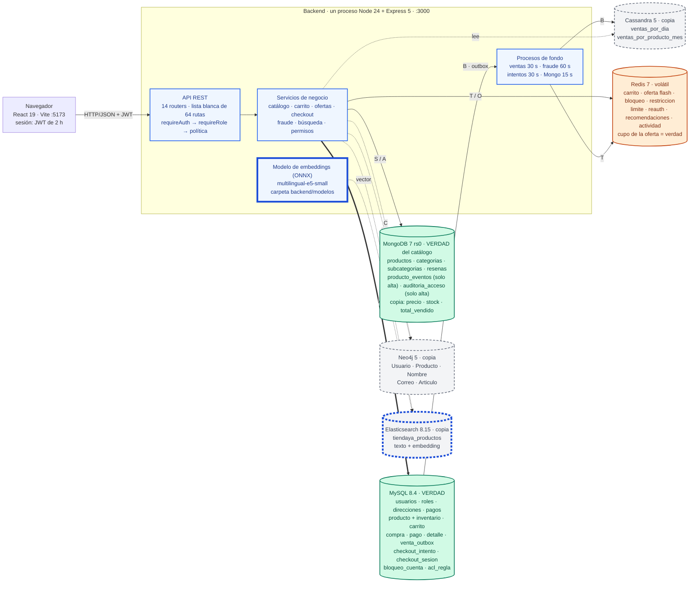
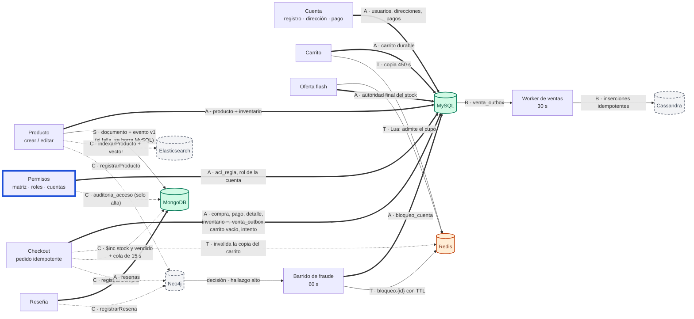
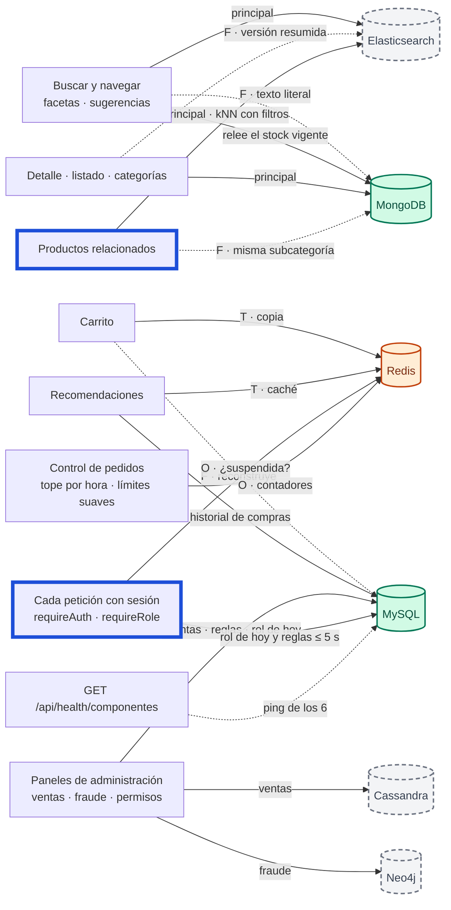
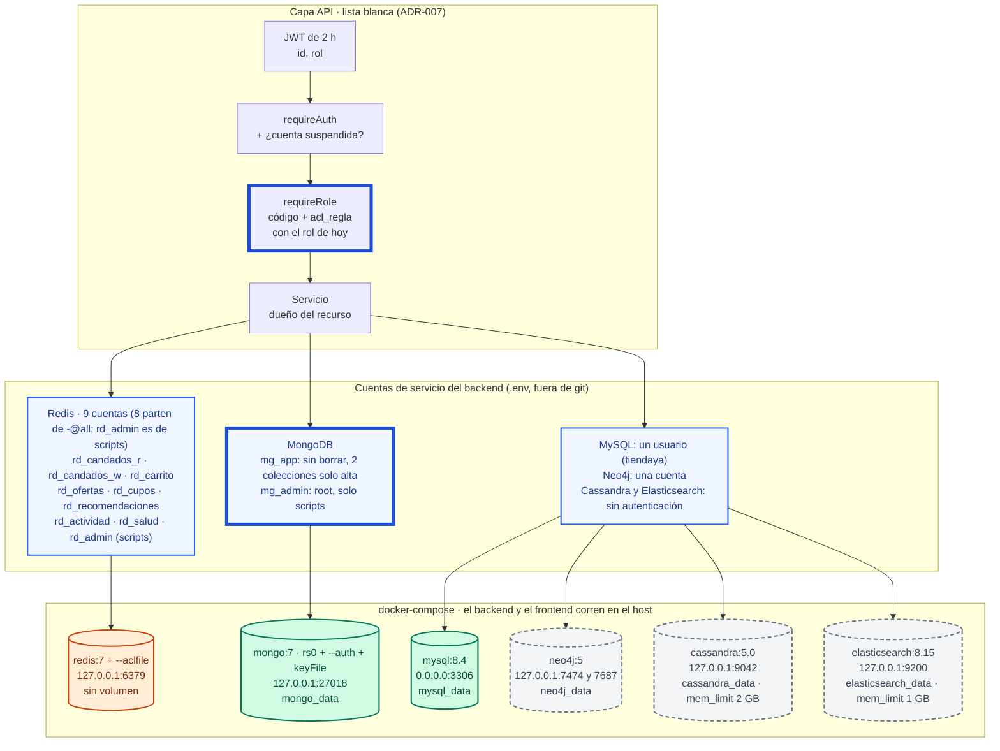

# Arquitectura final de TiendaYa (Entrega Final)

**Fecha:** 2026-10-25 · **Reemplaza a:** el diagrama de [ERD-ARQUITECTURA-POLIGLOTA.md §1.1](ERD-ARQUITECTURA-POLIGLOTA.md), que quedó atrás (no tiene `checkout_intento` ni `checkout_sesion`, las reseñas, los respaldos entre Mongo y Elasticsearch, la salud, el vector, la política de permisos ni tres de los cuatro procesos de fondo).

> Cubre el ítem «Diagrama de arquitectura final» de la Entrega Final (3 pts): **completo y correcto**. Una sola página con ~45 flechas fue lo que dejó cosas afuera; por eso son **cuatro vistas y una secuencia**, cada una con un tope de flechas, y una lista de chequeo que se aplica contra el repositorio. Qué se decidió y por qué: [ADR-001…007](.) y la [retrospectiva](RETROSPECTIVA.md); este documento solo dice **cómo es** el sistema hoy.

> **ESTADO: BORRADOR, verificado en parte (2026-10-25).** Los inventarios de la sección 1 se cotejaron a mano con `docker-compose.yml`, `schema.prisma`, los modelos de Mongoose, el CQL, `redisCuentas.js`, las consultas de Neo4j, `server.js` y `app.js`. **Pendiente:** (a) la prueba de deriva `backend/tests/arquitecturaDeriva.test.js` y el script `npm run test:arquitectura` (**todavía no existen**); (b) comprobar los nombres de función de la tabla de la sección 7 y el conteo de 64 rutas; (c) renderizar los cuatro diagramas Mermaid y exportar SVG/PNG a `IA/img/` (**la carpeta aún no existe**). Hasta cerrar (a)–(c), no presentar este archivo como «verificado».

La idea de la prueba de deriva: leer el bloque JSON de la sección 1 y compararlo con el código, de modo que agregar un contenedor, un modelo, una familia de llaves de Redis, una tabla de Cassandra, una etiqueta de Neo4j o un proceso de fondo sin tocar este archivo haga fallar la suite.

## 0. Leyenda

La garantía de cada flecha va como **letra en la etiqueta** (se lee igual en blanco y negro); el trazo ayuda pero no es lo único que la dice.

| Letra | Qué es | Trazo | Si falla el destino |
|---|---|---|---|
| **A** | Transacción ACID en una sola base | `==>` | Todo se revierte |
| **B** | Outbox durable e idempotente (la fila se escribe en la misma transacción A) | `-->` | Se reintenta con espera; nada se pierde ni se duplica |
| **C** | Mejor esfuerzo, con reparación idempotente | `-.->` | La venta o el cambio ya ocurrió; la copia queda atrás hasta que se repara |
| **S** | Dos pasos con compensación (si el segundo falla, se deshace el primero) | `-->` | El primero se borra a mano |
| **T** | Caché con TTL | `-->` | Se reconstruye desde la fuente |
| **F** | Respaldo de lectura: el otro almacén sirve cuando el principal cae | `-.->` | La interfaz avisa que la función está limitada |
| **O** | Control que **falla abierto** (si Redis no responde, no se bloquea a nadie) | `-->` | Se deja pasar y se avisa en el log |

Colores: **verde** = verdad de un dato · **gris con borde discontinuo** = copia derivada · **naranja** = control o caché volátil · **borde azul grueso** = nuevo en esta entrega. Excepciones de autoridad: el cupo de una oferta flash vive en Redis (la admisión), pero el stock real lo decide MySQL; el estado de publicación de un producto lo contesta Elasticsearch cuando Mongo está caído.

## 1. Inventario (lo que la prueba compara con el código)

```json inventario
{
  "contenedores": ["mysql", "mongo", "redis", "cassandra", "neo4j", "elasticsearch"],
  "clientes": ["prisma", "mongo", "redis", "cassandra", "neo4j", "elasticsearch"],
  "modelosPrisma": ["rol_usuario", "usuarios", "direcciones", "metodo_pago", "producto", "inventario", "carrito", "compra", "pago", "compra_detalle", "venta_outbox", "checkout_intento", "checkout_sesion", "bloqueo_cuenta", "acl_regla"],
  "modelosMongoose": ["AuditoriaAcceso", "Categoria", "Producto", "ProductoEvento", "Resena", "Subcategoria"],
  "familiasRedis": ["actividad:*", "bloqueo:*", "carrito:*", "checkout:reserva:*", "limite:pedidos:*", "oferta-recomendada:*", "oferta:*", "recomendaciones:*", "restriccion:*", "reauth:intentos:*"],
  "tablasCassandra": ["ventas_por_dia", "ventas_por_producto_mes"],
  "etiquetasNeo4j": ["Articulo", "Correo", "Nombre", "Producto", "Usuario"],
  "indiceElasticsearch": "tiendaya_productos",
  "procesosDeFondo": ["checkoutIntentoService", "bloqueoService", "reconciliacionMongoService", "ventasSyncService"],
  "routers": 14,
  "rutasDeclaradas": 64
}
```

| Almacén | Rol | Verdad de | Copia de | Se repara con |
|---|---|---|---|---|
| **MySQL 8.4** | Verdad transaccional | cuentas, roles, direcciones, métodos de pago, `producto` (ancla) e `inventario` (precio y stock autoritativos), carrito durable, pedidos (`compra`, `pago`, `compra_detalle`), intentos de checkout, `venta_outbox`, `bloqueo_cuenta`, `acl_regla` | — | — |
| **MongoDB 7** (replica set de un nodo) | Verdad del catálogo descriptivo y de dos registros *append-only* | `Producto` (descripción, estado, atributos, imágenes), `Categoria`, `Subcategoria`, `Resena`, `ProductoEvento` (historial), `AuditoriaAcceso` | `inventario.precio`, `inventario.cantidad` y `total_vendido` de cada `Producto` (de MySQL) | cola de reconciliación (15 s), `POST /api/admin/recalcular-inventario` y `-ventas` |
| **Redis 7** (sin persistencia) | Caché y controles volátiles | el **cupo** de una oferta flash (la admisión) | carrito (`carrito:*`, 450 s), recomendaciones, actividad, suspensiones y límites (`bloqueo:*`, `restriccion:*`, `limite:pedidos:*`, `reauth:intentos:*`) | se reconstruyen: el carrito desde MySQL, las suspensiones desde `bloqueo_cuenta` |
| **Cassandra 5** | Copia derivada analítica | — | `ventas_por_dia`, `ventas_por_producto_mes` (de `venta_outbox`) | el outbox (B); `npm run ventas:sincronizar` / `ventas:historico` |
| **Neo4j 5** | Copia derivada para detectar fraude | — | grafo de 5 etiquetas (de compras, reseñas y productos) | `npm run fraude:backfill` |
| **Elasticsearch 8.15** | Copia derivada de búsqueda **y** de vectores | — | índice `tiendaya_productos` (de Mongo) con el campo `embedding` | `npm run busqueda:backfill` (recalcula cada vector) |

Procesos de fondo del backend (los tres primeros arrancan en `server.js` y ninguno en `app.js`; el de Mongo se enciende solo cuando `encolar()` recibe un producto): `ventasSyncService` cada 30 s (`VENTAS_SYNC_ENABLED`, lote de 50), `bloqueoService` cada 60 s (`FRAUDE_BLOQUEO_ENABLED`; primer barrido a los 3 s), `checkoutIntentoService` cada 30 s y `reconciliacionMongoService` cada 15 s mientras haya pendientes (arranca solo cuando se encola algo; la lista vive en memoria).

## 2. V1 — Contenedores y quién es la verdad



El detalle de cada flecha está en las vistas siguientes y en la tabla de la sección 7.

## 3. V2a — Escrituras y sincronización (≤ 25 flechas)

Quién escribe qué y con qué garantía. Una flecha de un servicio a una **copia** nunca vuelve a la verdad, salvo la marcada «decisión» (el barrido de fraude escribe `bloqueo_cuenta`).



## 4. V2b — Lecturas, cachés y respaldos (≤ 25 flechas)



Con **Elasticsearch apagado** la búsqueda cae a Mongo (sin tolerancia a errores de tipeo) y los relacionados a «misma subcategoría»; con **Mongo apagado** el catálogo se sirve del índice (sin reseñas, ofertas ni historial) y los relacionados siguen por significado; con **ambos** apagados responde 503 con el nombre del componente. Con **Redis apagado** las ofertas flash se ocultan y los controles marcados **O** dejan pasar; si Redis *rechaza las credenciales*, en cambio, esos controles fallan **cerrado** (ADR-007 §4.4).

## 5. V3 — Despliegue y seguridad



Lo que queda **sin** cuenta por módulo (ADR-007 §8): MySQL (un solo usuario), Neo4j Community (solo autenticación, no tiene roles), Cassandra y Elasticsearch (sin autenticación en desarrollo). MySQL es el único contenedor publicado en todas las interfaces.

## 6. V4 — Secuencia del checkout: dónde cae cada fallo

```mermaid
sequenceDiagram
  autonumber
  actor U as Navegador
  participant A as API (auth + control de pedidos)
  participant K as checkout()
  participant R as Redis
  participant M as MySQL
  participant G as MongoDB
  participant N as Neo4j
  participant W as Worker de ventas
  participant C as Cassandra

  U->>A: POST /checkout/intentos
  A->>M: checkout_intento (UUID, versión del carrito)
  U->>A: POST /checkout {intentoId, dirección, pago}
  A->>R: ¿cuenta suspendida? · topes por hora
  Note over A,R: Redis caído: deja pasar (O). Credencial rechazada: falla cerrado, 500
  A->>K: checkout(...)
  K->>M: ¿el intento ya terminó?
  Note over K,M: Sí: devuelve el MISMO pedido, 200 (idempotente)
  K->>M: compromiso de no reventa · no es producto propio
  K->>G: ¿los productos están publicados?
  Note over K,G: Mongo caído: le pregunta a Elasticsearch. Ninguno responde: 503 antes de tocar nada
  K->>M: BEGIN
  K->>M: UPDATE inventario WHERE cantidad >= n
  K->>M: compra · pago · detalle · venta_outbox · vaciar carrito
  K->>M: COMMIT
  Note over K,M: Cualquier fallo antes del COMMIT: se revierte TODO. Falta stock: 409 sin descontar nada
  K->>R: invalida la copia del carrito
  K->>G: $inc total_vendido y stock
  Note over K,G: Mongo caído: la compra ya es definitiva; se anota para reconciliar en 15 s
  K->>N: registrarCompra
  Note over K,N: Neo4j caído: la compra sigue; npm run fraude:backfill la recupera
  K-->>U: 201 pedido confirmado
  W->>M: lee venta_outbox pendiente (cada 30 s)
  W->>C: inserta (idempotente)
  Note over W,C: Cassandra caída: el outbox espera con backoff y no se pierde nada
  U->>A: reenvía el mismo intento (se perdió la respuesta)
  A-->>U: 200 con el mismo pedido
```

## 7. Cada flecha: mecanismo, disparador, garantía y archivo

| # | Flecha | Mecanismo | Disparador | Garantía | Reparación | Archivo |
|---|---|---|---|---|---|---|
| 1 | Cuenta → MySQL | Prisma | registro, dirección, método de pago | A | — | `services/authService.js`, `direccionService.js`, `metodoPagoService.js` |
| 2 | Producto → MySQL | transacción de Prisma | `POST/PATCH /api/productos` | A | — | `services/productoService.js` |
| 3 | Producto → Mongo | documento + `ProductoEvento` v1 | el mismo | S | se borran las filas de MySQL | `productoService.crear` |
| 4 | Producto → Elasticsearch | `indexarProducto` (recalcula el vector; sin modelo, `update` parcial) | el mismo | C | `npm run busqueda:backfill` | `services/busquedaSyncService.js`, `embeddingService.js` |
| 5 | Producto → Neo4j | `registrarProducto` | el mismo | C | `npm run fraude:backfill` | `productoService.reenviarAlGrafo`, `fraudeSyncService.js` |
| 6 | Checkout → MySQL | una transacción (inventario, compra, pago, detalle, outbox, carrito, intento) | `POST /api/checkout` | A | — | `services/checkoutService.js`, `checkoutIntentoService.js` |
| 7 | Checkout → Redis | invalida `carrito:*` | después del COMMIT | T | TTL de 450 s | `cartService.invalidarCache` |
| 8 | Checkout → Mongo | `$inc` de `total_vendido` y `inventario.cantidad` | después del COMMIT | C | cola en memoria (15 s); `POST /api/admin/recalcular-*` | `checkoutService.js`, `reconciliacionMongoService.js`, `catalogoSyncService.js` |
| 9 | Checkout → Neo4j | `registrarCompra` | después del COMMIT | C | `npm run fraude:backfill` | `fraudeSyncService.js` |
| 10 | `venta_outbox` → Cassandra | worker con lote de 50 e inserciones idempotentes | cada 30 s (`VENTAS_SYNC_ENABLED`) | B | `npm run ventas:sincronizar` / `ventas:historico` | `services/ventasOutboxService.js`, `ventasSyncService.js` |
| 11 | Reseña → Mongo y Neo4j | documento; `registrarResena` | `POST /api/productos/:id/resenas` | A / C | `fraude:backfill` | `services/resenaService.js` |
| 12 | Carrito → MySQL y Redis | durable en MySQL; copia con script Lua y revisión | `/api/carrito/*` | A / T | se reconstruye desde MySQL | `services/cartService.js` |
| 13 | Oferta flash → Redis y MySQL | Lua atómico (admisión) y `checkoutOferta` (autoridad) | `/api/ofertas/*` | T / A | el cupo se repone si MySQL rechaza | `services/ofertaFlashService.js`, `checkoutService.js` |
| 14 | Neo4j → `bloqueo_cuenta` | el barrido convierte un hallazgo alto en una suspensión | cada 60 s (`FRAUDE_BLOQUEO_ENABLED`) | A (decisión) | `reconciliar()` reconstruye Redis desde MySQL | `services/bloqueoService.js`, `fraudeService.js` |
| 15 | `bloqueo_cuenta` → Redis | `bloqueo:{id}` y `restriccion:{id}` con TTL | el mismo barrido o un administrador | T | desde MySQL | `suspensionService.js`, `restriccionService.js`, `candadoRedis.js` |
| 16 | Permisos → MySQL | `acl_regla` en una transacción, todo o nada | `PUT /api/admin/permisos` | A | `Restaurar` | `services/politicaAccesoService.js` |
| 17 | Permisos y denegaciones → Mongo | `auditoria_acceso`, solo alta | cada cambio y cada 403 (una vez por minuto) | C | — | `services/auditoriaAccesoService.js` |
| 18 | Búsqueda ⇄ Mongo | respaldo cruzado de lectura | Elasticsearch o Mongo caídos | F | — | `services/catalogoLecturaService.js` |
| 19 | Relacionados → Elasticsearch | kNN (`embedding`, coseno, τ 0,90) con filtros dentro | `GET /api/productos/:id/relacionados` | F (Mongo) | — | `busquedaService.similares`, `reglasRelacionados.js` |
| 20 | Cada petición → Redis | `¿cuenta suspendida?` | `requireAuth` | O | — | `middleware/auth.js`, `suspensionService.js` |
| 21 | Cada ruta por roles → MySQL | rol de hoy y reglas, copia de ≤ 5 s | `requireRole` | — | si MySQL cae: la última copia o el código | `politicaAccesoService.js` |
| 22 | Pedido → Redis | tope por hora y límites suaves | `middleware/controlPedidos.js` | O | — | `limitePedidosService.js`, `restriccionService.js` |

## 8. Lista de chequeo «completo y correcto»

Aplicada **en parte** el 2026-10-25 contra el repositorio. ✔ = comprobado en el archivo que se nombra; **!** = hallazgo, ver la sección 9; ✘ = pendiente. NO comprobados todavía: los nombres de función de la tabla de la sección 7, el conteo de 64 rutas / 14 routers en la prueba, y el renderizado de los diagramas.

| # | Punto | Estado | Dónde se comprobó |
|---|---|---|---|
| 1 | Cada servicio de `docker-compose.yml` con puerto, volumen, `mem_limit` y enlace (0.0.0.0 o 127.0.0.1) | ✔ (V3) · **!** MySQL en 0.0.0.0; solo Cassandra (2 GB) y Elasticsearch (1 GB) tienen `mem_limit` | `docker-compose.yml` |
| 2 | Cada `backend/src/config/*.js` que es un cliente (6), con sus tiempos y cortacircuito | ✔ prisma (acquire 2,5 s, connect 2 s) · mongo (2 s, apertura 3 s) · redis (comando 1,5 s, 1 reintento) · cassandra (connect 2 s, lectura 5 s, apertura 5 s) · neo4j (1,5 s, apertura 5 s) · elasticsearch (2 s, sin reintentos, apertura 5 s) | `config/*.js`, `utils/resiliencia.js` |
| 3 | Cada modelo de Prisma (15) y de Mongoose (6), cada familia de llaves de Redis (10), las 2 tablas CQL, las 5 etiquetas de Neo4j, el índice de Elasticsearch y el artefacto vectorial | ✔ el inventario de la sección 1, cotejado a mano (la prueba que lo vigilará aún no existe) | `prisma/schema.prisma`, `models/mongo/`, `config/redisCuentas.js`, `docker/cassandra-init/01-schema.cql`, `fraudeSyncService.js`, `config/elasticsearch.js`, `config/embeddingsModelo.js` |
| 4 | Cada proceso periódico de `server.js` y la cola de reconciliación, con intervalo y bandera | ✔ sección 1 (4 procesos) | `server.js`, los cuatro servicios |
| 5 | Cada flecha entre almacenes con mecanismo, disparador, garantía y archivo | ✔ sección 7 (22 filas) | — |
| 6 | Toda copia apunta a su fuente y a su reparación; ninguna flecha copia → verdad salvo la «decisión» | ✔ la única es Neo4j → `bloqueo_cuenta` (fila 14); el hallazgo es una señal, la decisión queda durable en MySQL | `bloqueoService.js` |
| 7 | Respaldos (F) y controles que fallan abiertos (O) marcados; excepciones de autoridad declaradas | ✔ V2b y la leyenda | `catalogoLecturaService.js`, `suspensionService.js` |
| 8 | Lo nuevo resaltado y con su comportamiento ante una caída | ✔ vector (sección 4 y [ADR-006](ADR-006-recomendacion-semantica-vectorial.md) §3.5), cuentas de servicio y política de permisos ([ADR-007](ADR-007-control-de-acceso.md) §4.4 y §9.6) | — |
| 9 | Banderas y cifras iguales a `.env.example` y al compose | ✔ intervalos y topes · **!** `.env.example` trae `VENTAS_OUTBOX_ENABLED=false` y `VENTAS_SYNC_ENABLED=false` mientras el código los enciende por omisión | `.env.example`, `ventasSyncService.js` |
| 10 | Leyenda legible en blanco y negro; fuente Mermaid y SVG/PNG versionados | ✘ pendiente: la garantía ya va en la etiqueta de cada flecha; faltan validar el Mermaid y exportar SVG/PNG a `IA/img/` (la carpeta aún no existe) | — |
| 11 | Prueba de deriva (*fitness function*) | ✘ pendiente: ni el script `npm run test:arquitectura` ni la prueba existen todavía | `backend/tests/arquitecturaDeriva.test.js` |

## 9. Hallazgos al hacer el chequeo

1. **`.env.example` apaga el outbox y el worker de ventas** (`VENTAS_OUTBOX_ENABLED=false`, `VENTAS_SYNC_ENABLED=false`; el propio archivo dice «pausada temporalmente durante las pruebas de oferta flash»), pero el código los enciende cuando la variable falta (el `.env` de desarrollo de esta máquina tiene `VENTAS_SYNC_ENABLED=true` y no define el del outbox). Quien clone el repositorio y copie ese archivo deja el panel de ventas de Cassandra sin alimentar. Decisión del equipo: encenderlos en el ejemplo (lo recomendado para la demostración) o documentar por qué están apagados.
2. **MySQL es el único contenedor publicado en todas las interfaces** (`3306:3306`); los otros cinco están en `127.0.0.1`.
3. **El replica set de un nodo no se usa para transacciones**: [ADR-003](ADR-003-historial-cambios-eventos.md) lo justifica por «actualizar el documento y grabar el evento» atómicos, pero `productoService` hace `Producto.create` y luego `ProductoEvento.create` en secuencia (no hay `startSession` ni `withTransaction` en `src/`; solo en el ensayo de pagos, `scripts/spike-pagos/`). El historial puede quedar atrás ante un fallo a medias. Se trata en la [retrospectiva](RETROSPECTIVA.md).
4. **Sin `mem_limit`** en MySQL, MongoDB, Redis ni Neo4j: en un portátil de 16 GB con 1,4 GB libres, esos cuatro compiten con el resto.
