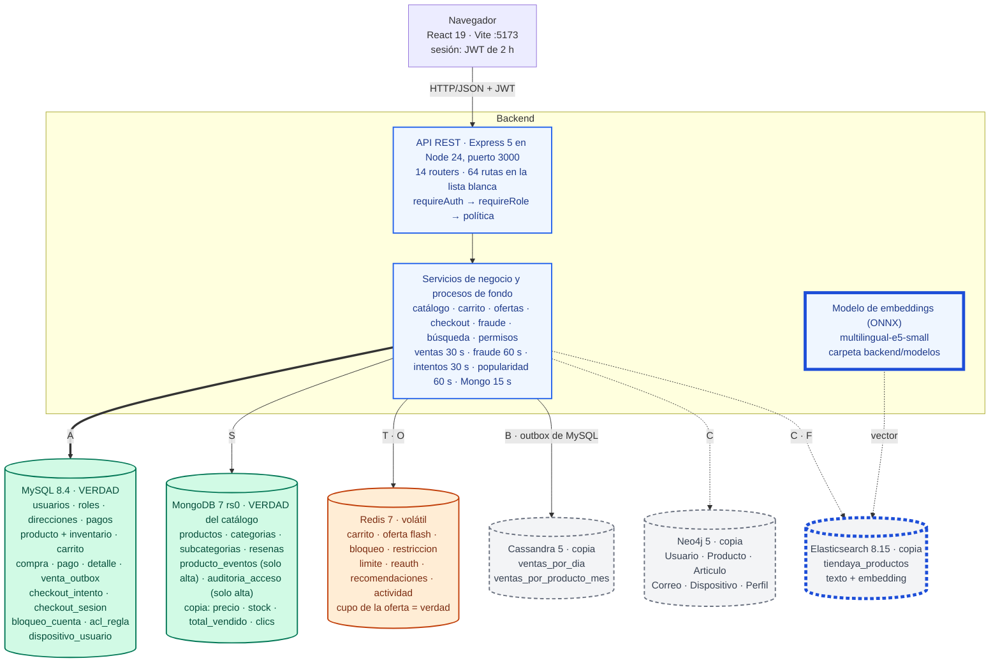
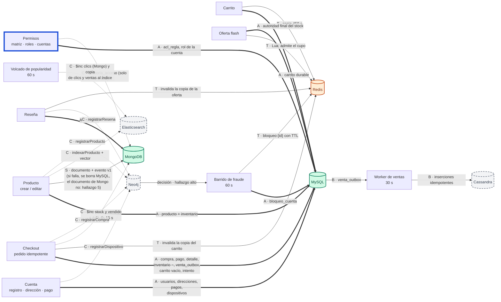
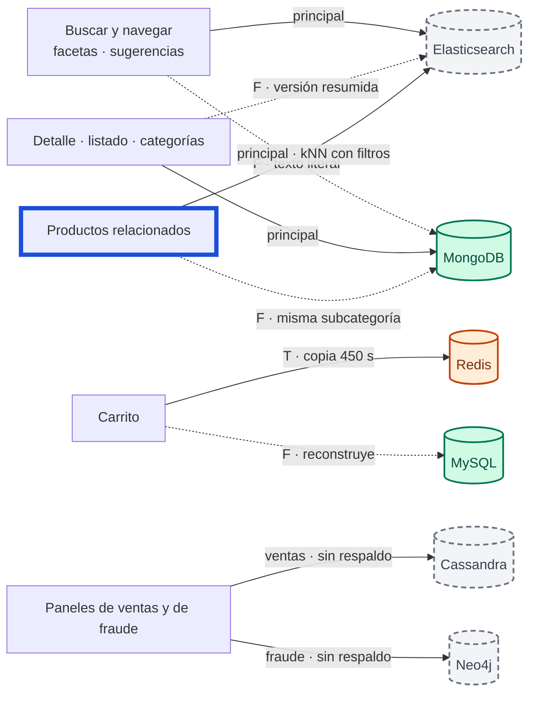
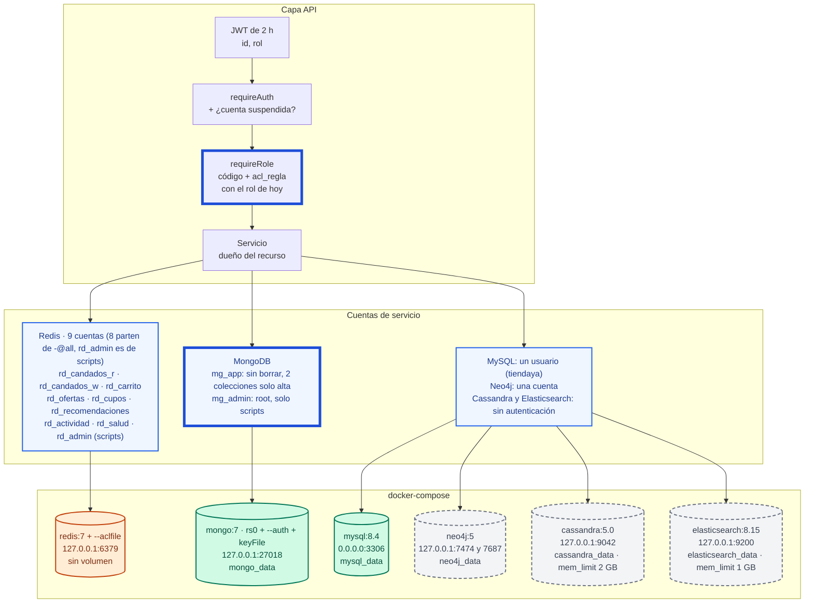
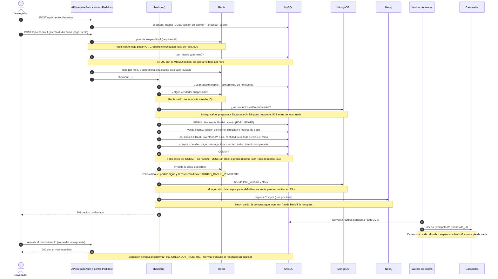

# Arquitectura final de TiendaYa (Entrega Final)

**Fecha:** 2026-10-25 · **Reemplaza a:** el diagrama de [ERD-ARQUITECTURA-POLIGLOTA.md §1.1](ERD-ARQUITECTURA-POLIGLOTA.md), que quedó en el 2026-10-04 (el archivo no menciona `checkout_intento`, `checkout_sesion`, `acl_regla`, la salud de los componentes ni los vectores).

> Cubre el ítem «Diagrama de arquitectura final» de la Entrega Final (3 pts): **completo y correcto**. Una sola página con todas las flechas no se lee; por eso son **cuatro vistas y una secuencia**, cada una con un tope de 25 flechas, y una lista de chequeo que se aplica contra el repositorio. Qué se decidió y por qué: [ADR-001…007](.) y la [retrospectiva](RETROSPECTIVA.md); este documento solo dice **cómo es** el sistema hoy.

> **Verificación (2026-10-25).** `npm run test:arquitectura` (14 pruebas, sin abrir ninguna conexión) compara el inventario de la sección 1 con `docker-compose.yml`, `schema.prisma`, los modelos de Mongoose, el CQL, `redisCuentas.js`, las consultas de Neo4j, `server.js`, `app.js` y `politicaRutas.js`; revisa que los diagramas no tengan nodos fantasma, `subgraph` sin cerrar ni más de 25 flechas por vista; y que la tabla de la sección 7 cite archivos, funciones y rutas que existen. A la prueba se le hicieron 24 mutaciones (un cambio por vez en el documento o en un diagrama) y detectó las 24. Los cinco diagramas renderizan sin errores con Mermaid 11.4.1 y están exportados en [`IA/img/`](img/) (SVG y PNG; etiquetas sin `foreignObject`, para que abran en cualquier visor). Lo que una prueba no puede decir —que cada flecha dibujada sea la correcta— se contrastó con el código de los servicios que la dibujan (sección 8).

Agregar un contenedor, un modelo, una familia de llaves de Redis, una tabla de Cassandra, una etiqueta de Neo4j o un proceso de fondo sin tocar este archivo hace fallar la suite. Las imágenes de `IA/img/` salen de los bloques Mermaid de este archivo: si se cambia un diagrama hay que volver a exportarlas, para que no queden atrasadas.

## 0. Leyenda

La garantía de cada flecha va como **letra en la etiqueta** (se lee igual en blanco y negro); el trazo ayuda pero no es lo único que la dice.

| Letra | Qué es | Trazo | Si falla el destino |
|---|---|---|---|
| **A** | Transacción ACID en una sola base | `==>` | Todo se revierte |
| **B** | Outbox durable e idempotente (la fila se escribe en la misma transacción A) | `-->` | Se reintenta con espera; nada se pierde ni se duplica |
| **C** | Mejor esfuerzo, con reparación idempotente | `-.->` | La venta o el cambio ya ocurrió; la copia queda atrás hasta que se repara |
| **S** | Dos pasos con compensación (si el segundo falla, se deshace el primero) | `-->` | El primero se borra a mano |
| **T** | Caché con TTL | `-->` | Se reconstruye desde la fuente |
| **F** | Respaldo de lectura: el otro almacén sirve cuando el principal cae | `-.->` | La interfaz avisa que la función está limitada |
| **O** | Control que **falla abierto** (si Redis no responde, no se bloquea a nadie) | `-->` | Se deja pasar y se avisa en el log |

Colores: **verde** = verdad de un dato · **gris con borde discontinuo** = copia derivada · **naranja** = control o caché volátil · **borde azul grueso** = nuevo en esta entrega. Excepciones de autoridad: el cupo de una oferta flash vive en Redis (la admisión), pero el stock real lo decide MySQL; el estado de publicación de un producto lo contesta Elasticsearch cuando Mongo está caído.

## 1. Inventario (lo que la prueba compara con el código)

```json inventario
{
  "contenedores": ["mysql", "mongo", "redis", "cassandra", "neo4j", "elasticsearch"],
  "configuracion": ["cassandra", "elasticsearch", "embeddingsModelo", "mongo", "mongoCuentas", "neo4j", "politicaRutas", "prisma", "redis", "redisCuentas"],
  "clientes": ["prisma", "mongo", "redis", "cassandra", "neo4j", "elasticsearch"],
  "modelosPrisma": ["rol_usuario", "usuarios", "direcciones", "metodo_pago", "producto", "inventario", "carrito", "compra", "pago", "compra_detalle", "venta_outbox", "checkout_intento", "checkout_sesion", "bloqueo_cuenta", "acl_regla", "dispositivo_usuario"],
  "modelosMongoose": ["AuditoriaAcceso", "Categoria", "Producto", "ProductoEvento", "Resena", "Subcategoria"],
  "familiasRedis": ["actividad:*", "bloqueo:*", "carrito:*", "checkout:reserva:*", "limite:pedidos:*", "oferta-recomendada:*", "oferta:*", "recomendaciones:*", "restriccion:*", "reauth:intentos:*"],
  "tablasCassandra": ["ventas_por_dia", "ventas_por_producto_mes"],
  "etiquetasNeo4j": ["Articulo", "Correo", "Dispositivo", "Perfil", "Producto", "Usuario"],
  "indiceElasticsearch": "tiendaya_productos",
  "procesosDeFondo": {
    "arrancanEnServer": ["checkoutIntentoService", "bloqueoService", "ventasSyncService", "popularidadService"],
    "alEncolar": ["reconciliacionMongoService"]
  },
  "routers": 14,
  "rutasDeclaradas": 64
}
```

| Almacén | Rol | Verdad de | Copia de | Se repara con |
|---|---|---|---|---|
| **MySQL 8.4** | Verdad transaccional | cuentas, roles, direcciones, métodos de pago, `producto` (ancla) e `inventario` (precio y stock autoritativos), carrito durable, pedidos (`compra`, `pago`, `compra_detalle`), intentos de checkout, `venta_outbox`, `bloqueo_cuenta`, `acl_regla`, `dispositivo_usuario` (desde qué dispositivo entró cada cuenta, solo hashes) | — | — |
| **MongoDB 7** (replica set de un nodo) | Verdad del catálogo descriptivo y de dos registros *append-only* | `Producto` (descripción, estado, atributos, imágenes), `Categoria`, `Subcategoria`, `Resena`, `ProductoEvento` (historial), `AuditoriaAcceso` | `inventario.precio`, `inventario.cantidad` y `total_vendido` de cada `Producto` (de MySQL), su `resenas_resumen` (de la colección `Resena`) y sus `clics` (cada visita a la ficha, sumada cada 60 s: no tiene otra fuente) | cola de reconciliación (15 s), `POST /api/admin/recalcular-inventario` y `-ventas` |
| **Redis 7** (sin volumen: se vacía al recrear el contenedor) | Caché y controles volátiles | el **cupo** de una oferta flash (la admisión) | carrito (`carrito:*`, 450 s), recomendaciones, actividad, suspensiones y límites (`bloqueo:*`, `restriccion:*`, `limite:pedidos:*`, `reauth:intentos:*`) | se reconstruyen: el carrito desde MySQL, las suspensiones desde `bloqueo_cuenta` |
| **Cassandra 5** | Copia derivada analítica | — | `ventas_por_dia`, `ventas_por_producto_mes` (de `venta_outbox`) | el outbox (B); `npm run ventas:sincronizar` / `ventas:historico` |
| **Neo4j 5** | Copia derivada para detectar fraude | — | grafo de 6 etiquetas (de compras, reseñas, productos y de los dispositivos de `dispositivo_usuario`) | `npm run fraude:backfill` |
| **Elasticsearch 8.15** | Copia derivada de búsqueda **y** de vectores | — | índice `tiendaya_productos` (de Mongo) con el campo `embedding`, y con `total_vendido`, `clics` y `publicado_en` para ordenar por popularidad y novedad | `npm run busqueda:backfill` (recalcula cada vector; con `--solo-texto` no) |

Procesos de fondo del backend (los cuatro primeros arrancan en `server.js` y ninguno en `app.js`; el de Mongo se enciende solo cuando `encolar()` recibe un producto): `ventasSyncService` cada 30 s (`VENTAS_SYNC_ENABLED`, lote de 50), `bloqueoService` cada 60 s (`FRAUDE_BLOQUEO_ENABLED`; primer barrido a los 3 s), `checkoutIntentoService` cada 30 s (cierra los intentos de checkout que llevan más de 15 min sin confirmarse y devuelve las reservas de ofertas flash), `popularidadService` cada 60 s (`POPULARIDAD_ENABLED`: suma en Mongo los clics en la ficha de cada producto y copia al índice de búsqueda los clics y las ventas, que ordenan los resultados; el buffer vive en memoria y perder el último minuto solo cuesta ese minuto de clics) y `reconciliacionMongoService` cada 15 s mientras haya pendientes (arranca solo cuando se encola algo; la lista vive en memoria, hasta 5 000 productos).

## 2. V1 — Contenedores y quién es la verdad



Imagen exportada: [PNG](img/V1-contenedores.png) · [SVG](img/V1-contenedores.svg)

Las letras de las flechas son las de la leyenda (sección 0) y dicen cómo se alimenta cada almacén; el detalle de cada flecha está en las vistas siguientes y en la tabla de la sección 7. Las lecturas de los paneles de ventas y de fraude (Cassandra y Neo4j) están en la vista V2b.

## 3. V2a — Escrituras y sincronización (≤ 25 flechas)

Quién escribe qué y con qué garantía. Una flecha de un servicio a una **copia** nunca vuelve a la verdad, salvo la marcada «decisión» (el barrido de fraude escribe `bloqueo_cuenta`).



Imagen exportada: [PNG](img/V2a-escrituras-y-sincronizacion.png) · [SVG](img/V2a-escrituras-y-sincronizacion.svg)

## 4. V2b — Lecturas con respaldo

Qué pasa cuando el almacén principal de una lectura no responde. Las lecturas con un segundo camino (**F**) siguen funcionando; los paneles de ventas y de fraude no lo tienen, porque Cassandra y Neo4j son copias derivadas que no sirven a nadie más.



Imagen exportada: [PNG](img/V2b-lecturas-con-respaldo.png) · [SVG](img/V2b-lecturas-con-respaldo.svg)

Con **Elasticsearch apagado** la búsqueda cae a Mongo (sin tolerancia a errores de tipeo) y los relacionados a «misma subcategoría»; con **Mongo apagado** el catálogo se sirve del índice (sin reseñas, ofertas ni historial) y los relacionados siguen por significado; con **ambos** apagados el catálogo responde 503. Con **Redis apagado** el carrito se reconstruye desde MySQL, las ofertas flash se ocultan y los controles marcados **O** dejan pasar; si Redis *rechaza las credenciales*, en cambio, esos controles fallan **cerrado** (ADR-007 §4.4).

Las demás lecturas y controles no se dibujan para no saturar la vista:

| Lectura o control | Consulta a | Garantía | Si el almacén no responde |
|---|---|---|---|
| Cada petición con sesión (`requireAuth`) | Redis: ¿la cuenta está suspendida? | **O** | deja pasar y lo avisa en el log; si Redis **rechaza la credencial**, falla cerrado con 500 |
| Rutas por rol (`requireRole`) | MySQL: el rol de hoy y las reglas `acl_regla`, con una copia de ≤ 5 s | — | usa la última copia; sin ninguna, el código base (ADR-007 §9.6) |
| Control de pedidos (tope por hora, límites suaves) | Redis: contadores y casos abiertos | **O** | deja pasar |
| Resultados de búsqueda y relacionados | Mongo: relee el stock y las ventas vigentes (el índice no se entera de las compras) | — | se muestran los datos del índice |
| Recomendaciones | MySQL (historial de compras), Mongo (candidatos), Redis (caché de una hora y cupo personal) | **T** | sin Redis se recalculan en cada visita; comprar al precio recomendado exige Redis (el aviso ofrece comprar al precio normal) |
| `GET /api/health/componentes` | ping a los seis almacenes, con tope de 1,5 s cada uno | — | marca «degradado», o «crítico» si cae MySQL o caen Mongo y Elasticsearch juntos |

## 5. V3 — Despliegue y seguridad



Imagen exportada: [PNG](img/V3-despliegue-y-seguridad.png) · [SVG](img/V3-despliegue-y-seguridad.svg)

La capa de arriba es la lista blanca de la API ([ADR-007](ADR-007-control-de-acceso.md)); las cuentas de servicio viven en `backend/.env` (fuera de git) y los seis contenedores están en `docker-compose.yml`, mientras que el backend y el frontend corren en el equipo anfitrión, fuera de Docker. Lo que queda **sin** cuenta por módulo (ADR-007 §8): MySQL (un solo usuario), Neo4j Community (solo autenticación, no tiene roles), Cassandra y Elasticsearch (sin autenticación en desarrollo). MySQL es el único contenedor publicado en todas las interfaces.

## 6. V4 — Secuencia del checkout: dónde cae cada fallo



Imagen exportada: [PNG](img/V4-secuencia-del-checkout.png) · [SVG](img/V4-secuencia-del-checkout.svg)

## 7. Cada flecha: mecanismo, disparador, garantía y archivo

Las lecturas con respaldo se explican en la sección 4, y en su tabla las demás lecturas y los controles; aquí van las escrituras, la sincronización y los respaldos. La prueba de deriva comprueba que cada archivo, función y ruta que se cita en esta tabla exista.

| # | Flecha | Mecanismo | Disparador | Garantía | Reparación | Archivo |
|---|---|---|---|---|---|---|
| 1 | Cuenta → MySQL | Prisma | registro, dirección, método de pago | A | — | `services/authService.js`, `direccionService.js`, `metodoPagoService.js` |
| 2 | Producto → MySQL | transacción de Prisma | `POST /api/productos` y `PATCH /api/productos/:id` | A | — | `services/productoService.js` |
| 3 | Producto → Mongo | documento + `ProductoEvento` v1 | el mismo | S | se borran las filas de MySQL | `productoService.crear` |
| 4 | Producto → Elasticsearch | `indexarProducto` (recalcula el vector; sin modelo, `update` parcial) | el mismo | C | `npm run busqueda:backfill` | `services/busquedaSyncService.js`, `embeddingService.js` |
| 5 | Producto → Neo4j | `registrarProducto` | el mismo | C | `npm run fraude:backfill` | `productoService.reenviarAlGrafo`, `fraudeSyncService.js` |
| 6 | Checkout → MySQL | una transacción (inventario, compra, pago, detalle, outbox, carrito, intento) | `POST /api/checkout` | A | — | `services/checkoutService.js`, `checkoutIntentoService.js` |
| 7 | Checkout → Redis | invalida `carrito:*` | después del COMMIT | T | TTL de 450 s | `cartService.invalidarCache` |
| 8 | Checkout → Mongo | `$inc` de `total_vendido` y `inventario.cantidad` | después del COMMIT | C | cola en memoria (15 s); `POST /api/admin/recalcular-*` | `checkoutService.js`, `reconciliacionMongoService.js`, `catalogoSyncService.js` |
| 9 | Checkout → Neo4j | `registrarCompra` | después del COMMIT | C | `npm run fraude:backfill` | `fraudeSyncService.js` |
| 10 | `venta_outbox` → Cassandra | worker con lote de 50 e inserciones idempotentes | cada 30 s (`VENTAS_SYNC_ENABLED`) | B | `npm run ventas:sincronizar` / `ventas:historico` | `services/ventasOutboxService.js`, `ventasSyncService.js` |
| 11 | Reseña → Mongo, Redis y Neo4j | documento `Resena` y resumen de calificación del producto (Mongo); invalida la copia de la oferta (Redis); `registrarResena` (Neo4j) | `POST /api/productos/:id/resenas` | A / T / C | `fraude:backfill`; la copia de la oferta se regenera sola | `services/resenaService.js`, `ofertaDatosService.js` |
| 12 | Carrito → MySQL y Redis | durable en MySQL; copia con script Lua y revisión | `/api/carrito/*` | A / T | se reconstruye desde MySQL | `services/cartService.js` |
| 13 | Oferta flash → Redis y MySQL | Lua atómico (admisión) y `checkoutOferta` (autoridad) | `/api/ofertas/*` | T / A | el cupo se repone si MySQL rechaza | `services/ofertaFlashService.js`, `checkoutService.js` |
| 14 | Neo4j → `bloqueo_cuenta` | el barrido convierte un hallazgo alto en una suspensión | cada 60 s (`FRAUDE_BLOQUEO_ENABLED`) | A (decisión) | `reconciliar()` reconstruye Redis desde MySQL | `services/bloqueoService.js`, `fraudeService.js` |
| 15 | `bloqueo_cuenta` → Redis | `bloqueo:{id}` y `restriccion:{id}` con TTL | el mismo barrido o un administrador | T | desde MySQL | `suspensionService.js`, `restriccionService.js`, `candadoRedis.js` |
| 16 | Permisos → MySQL | `acl_regla` en una transacción, todo o nada | `PUT /api/admin/permisos` | A | `Restaurar` | `services/politicaAccesoService.js` |
| 17 | Permisos y denegaciones → Mongo | `auditoria_acceso`, solo alta | cada cambio y cada 403 (una vez por minuto) | C | — | `services/auditoriaAccesoService.js` |
| 18 | Búsqueda ⇄ Mongo | respaldo cruzado de lectura | Elasticsearch o Mongo caídos | F | — | `services/catalogoLecturaService.js` |
| 19 | Relacionados → Elasticsearch | kNN (`embedding`, coseno, τ 0,90) con filtros dentro | `GET /api/productos/:id/relacionados` | F (Mongo) | — | `busquedaService.similares`, `reglasRelacionados.js` |
| 20 | Cada petición → Redis | ¿cuenta suspendida? | `requireAuth` | O | — | `middleware/auth.js`, `suspensionService.js` |
| 21 | Cada ruta por roles → MySQL | rol de hoy y reglas, copia de ≤ 5 s | `requireRole` | — | si MySQL cae: la última copia o el código | `politicaAccesoService.js` |
| 22 | Pedido → Redis | tope por hora y límites suaves | `middleware/controlPedidos.js` | O | — | `limitePedidosService.js`, `restriccionService.js` |
| 23 | Inicio de sesión y registro → MySQL y Neo4j | fila `dispositivo_usuario` (solo hashes) y `registrarDispositivo` (nodos `Dispositivo` y `Perfil`); el reenvío al grafo no se espera | `POST /api/auth/login` y `POST /api/auth/registro` | A / C | `npm run fraude:backfill` (reconstruye el grafo desde `dispositivo_usuario`) | `services/dispositivoService.js`, `authService.js`, `fraudeSyncService.js` |
| 24 | Clics y ventas → Mongo y Elasticsearch | buffer en memoria; cada 60 s `$inc` de `clics` y una petición `_bulk` con los valores vigentes (`clics`, `total_vendido`) | `GET /api/productos/:id` (un clic por visitante cada 30 min) y cada checkout (marca el producto) | C | `npm run busqueda:backfill` | `services/popularidadService.js`, `rankingBusqueda.js`, `checkoutService.js` |

## 8. Lista de chequeo «completo y correcto»

Aplicada el 2026-10-25 contra el repositorio. ✔ = comprobado en el archivo que se nombra; **!** = hallazgo, ver la sección 9.

| # | Punto | Estado | Dónde se comprobó |
|---|---|---|---|
| 1 | Cada servicio de `docker-compose.yml` con puerto, volumen, `mem_limit` y enlace (0.0.0.0 o 127.0.0.1) | ✔ (V3) · **!** MySQL en 0.0.0.0; solo Cassandra (2 GB) y Elasticsearch (1 GB) tienen `mem_limit` | `docker-compose.yml` |
| 2 | Cada `backend/src/config/*.js` que es un cliente (6), con sus tiempos y cortacircuito | ✔ prisma (acquire 2,5 s, connect 2 s) · mongo (2 s, apertura 3 s) · redis (comando 1,5 s, 1 reintento) · cassandra (connect 2 s, lectura 5 s, apertura 5 s) · neo4j (1,5 s, apertura 5 s) · elasticsearch (2 s, sin reintentos, apertura 5 s) | `config/*.js`, `utils/resiliencia.js` |
| 3 | Cada modelo de Prisma (15) y de Mongoose (6), cada familia de llaves de Redis (10), las 2 tablas CQL, las 5 etiquetas de Neo4j, el índice de Elasticsearch y el artefacto vectorial | ✔ el inventario de la sección 1, vigilado por `npm run test:arquitectura` | `prisma/schema.prisma`, `models/mongo/`, `config/redisCuentas.js`, `docker/cassandra-init/01-schema.cql`, `fraudeSyncService.js`, `config/elasticsearch.js`, `config/embeddingsModelo.js` |
| 4 | Cada proceso periódico de `server.js` y la cola de reconciliación, con intervalo y bandera | ✔ sección 1 (4 procesos) | `server.js`, los cuatro servicios |
| 5 | Cada flecha entre almacenes con mecanismo, disparador, garantía y archivo | ✔ sección 7 (22 filas) y tabla de la sección 4 (lecturas y controles sin respaldo); la prueba comprueba que los archivos, funciones y rutas citados existan | `backend/tests/arquitecturaDeriva.test.js` |
| 6 | Toda copia apunta a su fuente y a su reparación; ninguna flecha copia → verdad salvo la «decisión» | ✔ la única es Neo4j → `bloqueo_cuenta` (fila 14); el hallazgo es una señal, la decisión queda durable en MySQL | `bloqueoService.js` |
| 7 | Respaldos (F) y controles que fallan abiertos (O) marcados; excepciones de autoridad declaradas | ✔ V2b y la leyenda | `catalogoLecturaService.js`, `suspensionService.js` |
| 8 | Lo nuevo resaltado y con su comportamiento ante una caída | ✔ vector (sección 4 y [ADR-006](ADR-006-recomendacion-semantica-vectorial.md) §3.5), cuentas de servicio y política de permisos ([ADR-007](ADR-007-control-de-acceso.md) §4.4 y §9.6) | — |
| 9 | Banderas y cifras iguales a `.env.example` y al compose | ✔ intervalos y topes · **!** `.env.example` trae `VENTAS_OUTBOX_ENABLED=false` y `VENTAS_SYNC_ENABLED=false` mientras el código los enciende por omisión | `.env.example`, `ventasSyncService.js` |
| 10 | Leyenda legible en blanco y negro; fuente Mermaid y SVG/PNG versionados | ✔ la garantía va en la etiqueta de cada flecha; los cinco diagramas renderizan sin errores con Mermaid 11.4.1 y están exportados en [img/](img/) (SVG y PNG) | — |
| 11 | Prueba de deriva (*fitness function*) | ✔ `npm run test:arquitectura`: 14 pruebas, y detecta las 24 mutaciones con que se probó (un cambio del documento o de un diagrama por vez) | `backend/tests/arquitecturaDeriva.test.js` |

## 9. Hallazgos al hacer el chequeo

1. **`.env.example` apaga el outbox y el worker de ventas** (`VENTAS_OUTBOX_ENABLED=false`, `VENTAS_SYNC_ENABLED=false`; el propio archivo dice «pausada temporalmente durante las pruebas de oferta flash»), pero el código los enciende cuando la variable falta (el `.env` de desarrollo de esta máquina tiene `VENTAS_SYNC_ENABLED=true` y no define el del outbox). Quien clone el repositorio y copie ese archivo deja el panel de ventas de Cassandra sin alimentar. Decisión del equipo: encenderlos en el ejemplo (lo recomendado para la demostración) o documentar por qué están apagados.
2. **MySQL es el único contenedor publicado en todas las interfaces** (`3306:3306`); los otros cinco están en `127.0.0.1`.
3. **El replica set de un nodo no se usa para transacciones**: [ADR-003 §3.2](ADR-003-historial-cambios-eventos.md) exige que «actualizar el documento vigente» y «grabar el evento» sean atómicos (por eso el compose levanta Mongo como replica set), pero `productoService` hace `Producto.create` y luego `ProductoEvento.create` en secuencia (no hay `startSession` ni `withTransaction` en `src/`; solo en el ensayo de pagos, `scripts/spike-pagos/`). El historial puede quedar atrás ante un fallo a medias. Se trata en la [retrospectiva](RETROSPECTIVA.md).
4. **Sin `mem_limit`** en MySQL, MongoDB, Redis ni Neo4j: cuando se midió (2026-10-22) el equipo de desarrollo tenía unos 1,4 GB libres y Elasticsearch ya usaba 961 MiB de su 1 GiB; esos cuatro contenedores compiten con el resto.
5. **La compensación de `productoService.crear` no borra el documento de Mongo.** Ya está documentado y medido contra las bases reales ([ENTREGA-3 §4](ENTREGA-3-CONSISTENCIA.md), 2026-10-06, «arreglo propuesto, no aplicado»); la lectura del código del 2026-10-25 confirma que sigue igual. Si `ProductoEvento.create` o la relectura `obtener()` fallan después de que `Producto.create` ya escribió, el `catch` borra las filas de MySQL (`inventario` y `producto`) pero deja el documento de Mongo —la fuente del catálogo— sin ancla en MySQL: se vería en el catálogo y no se podría comprar. Es el mismo hueco que el hallazgo 3: sin transacción de Mongo, el segundo paso no se deshace. Se trata en la [retrospectiva](RETROSPECTIVA.md).
6. **Contraseñas por defecto visibles en el repositorio**: `rootpass` y `tiendaya` (MySQL, `docker-compose.yml`), `tiendaya_dev` (Neo4j, compose y `config/neo4j.js`) y `dev-secret-cambiar-en-produccion` (JWT, `.env.example`). Aceptable en desarrollo; es lo primero que cambia una puesta en producción.
