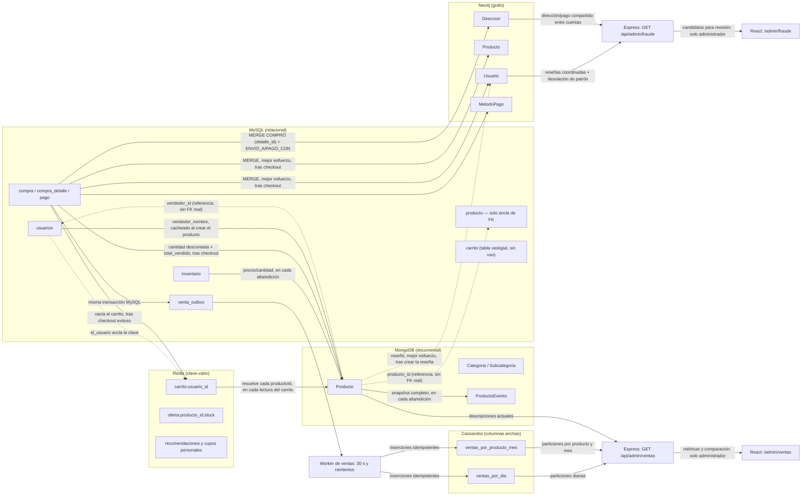
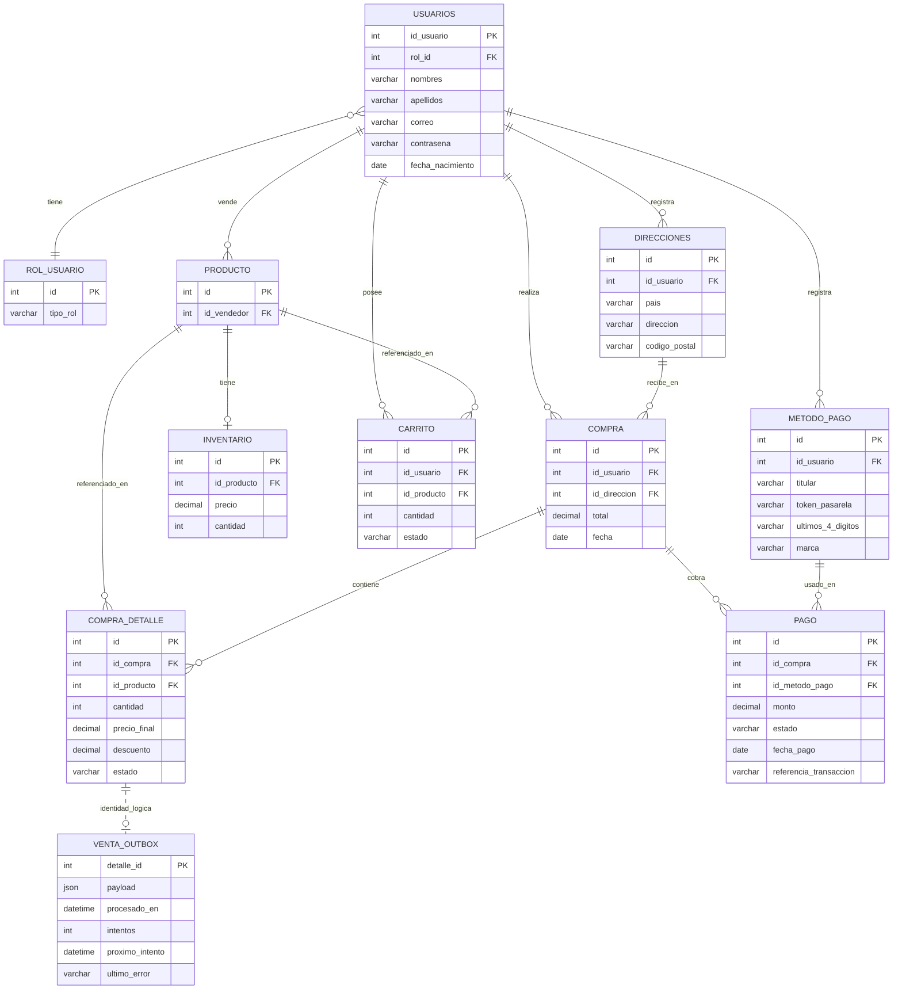

# ERD — Arquitectura políglota (actualizado, 2026-09-09)

> Este documento reúne el modelo de MySQL, MongoDB, Redis, Cassandra (copia analítica de ventas) y Neo4j (detección de fraude). Describe responsabilidades y relaciones; no acredita por sí solo que los contenedores estén corriendo. El estado de comprobaciones está en [ESTADO-PROYECTO.md §3.10](ESTADO-PROYECTO.md#310-entrega-2--panel-de-ventas-con-cassandra) (Cassandra) y §3.11 (Neo4j). [ERD.md](ERD.md) conserva el modelo relacional histórico de la Fase Inicial.
>
> El PRD exige implementar **al menos una** familia entre grafos y columnar. El equipo terminó incorporando las dos — Cassandra para ventas ([ADR-004](ADR-004-analitica-ventas-cassandra.md)), Neo4j para fraude ([PLAN-NEO4J-DETECCION-FRAUDE.md](PLAN-NEO4J-DETECCION-FRAUDE.md)) — no una en lugar de la otra. La versión anterior de este documento (2026-09-04) todavía decía que Cassandra reemplazaba a Neo4j; eso quedó desactualizado el mismo día que se implementó Neo4j (2026-09-08).

---

## 1. Panorama general: quién es dueño de qué

| Base | Rol | Qué le pertenece |
|---|---|---|
| **MySQL** | Fuente transaccional única | Usuarios/auth, direcciones, métodos de pago, inventario (precio/cantidad reales), compras/pagos y `venta_outbox` capturado en la misma transacción de la venta |
| **MongoDB** | Fuente del catálogo descriptivo + historial | Categorías, subcategorías, contenido de producto (descripción/atributos/imágenes/estado), historial de cambios por evento |
| **Redis** | Estado temporal y admisión atómica | Carrito con TTL de 7.5 min, cupos de ofertas y recomendaciones cacheadas; MySQL sigue siendo autoridad del inventario vendido |
| **Cassandra** | Copia analítica de ventas | Proyecciones por día y por producto/mes, reconstruibles desde las ventas pagadas en MySQL; importes y unidades del panel |
| **Neo4j** | Copia analítica de fraude | Grafo de usuarios/productos/direcciones/métodos de pago derivado de compras y reseñas ya confirmadas; reconstruible con `fraude:backfill` |

Las copias no cambian la autoridad de cada dato. El catálogo conserva reenvíos de mejor esfuerzo ya documentados; las ventas hacia Cassandra incorporan **outbox durable con reintentos idempotentes**; el fraude hacia Neo4j es mejor esfuerzo, como el catálogo (ver §7, por qué no necesita la garantía dura de Cassandra). Las referencias entre bases son IDs sin claves foráneas distribuidas. El detalle está en §5, el modelo de Cassandra en §6 y el de Neo4j en §7.

### 1.1 Diagrama de interacción



**Cómo leer las flechas:** línea sólida = escritura, entrega o lectura identificada por su etiqueta. Los reenvíos del catálogo son de mejor esfuerzo; la entrega a Cassandra queda respaldada por outbox en MySQL. Línea punteada = referencia simple sin integridad referencial entre bases (ver [ADR-002](ADR-002-migracion-catalogo-documental.md), sección 6.3).

**Dirección de autoridad:** ninguna copia reconstruye ventas o inventario SQL desde Mongo, Redis o Cassandra. El worker sí marca el estado de entrega de su outbox en MySQL después de escribir Cassandra; eso no convierte a Cassandra en fuente de las ventas. La decisión previa de descartar CDC bidireccional de catálogo sigue vigente ([ADR-002 §3.5](ADR-002-migracion-catalogo-documental.md#35-considerado-y-descartado-2026-08-30-worker-de-sincronización-cdc-bidireccional)); el outbox unidireccional de ventas resuelve otro alcance.

---

## 2. MySQL (relacional)

Esquema completo en [`backend/prisma/schema.prisma`](../backend/prisma/schema.prisma). Desde el 2026-08-30 ([ADR-002 §3.4](ADR-002-migracion-catalogo-documental.md#34-actualización-2026-08-30-se-borra-el-catálogo-relacional-vestigial)) ya no incluye el catálogo relacional (`categoria`, `subcategoria`, `atributo_categoria`, `atributo_producto`, `categoria_producto`) — esas tablas se borraron por completo, no están vacías, no existen.

### 2.1 Entidades

| Entidad | PK | FK | Otros campos | Nota |
|---|---|---|---|---|
| `usuarios` | id_usuario | rol_id | nombres, apellidos, correo, contrasena, fecha_nacimiento | — |
| `rol_usuario` | id | — | tipo_rol | — |
| `direcciones` | id | id_usuario | pais, direccion, codigo_postal | — |
| `metodo_pago` | id | id_usuario | titular, token_pasarela, ultimos_4_digitos, marca | número completo/CVV nunca se guardan |
| `producto` | id | id_vendedor | — | **solo ancla de FK** desde Entrega 1 — lo descriptivo vive en Mongo |
| `inventario` | id | id_producto (único, 1:1) | precio, cantidad | fuente transaccional real de precio/stock |
| `carrito` | id | id_usuario, id_producto | cantidad, estado | **vestigial, sin uso** — el carrito real vive en Redis desde Entrega 2, esta tabla nunca se escribe ni se lee en código vivo |
| `compra` | id | id_usuario, id_direccion | total, fecha | — |
| `pago` | id | id_compra, id_metodo_pago | monto, estado, fecha_pago, referencia_transaccion | — |
| `compra_detalle` | id | id_compra, id_producto | cantidad, precio_final, descuento, estado | — |
| `venta_outbox` | detalle_id | — | payload, procesado_en, intentos, proximo_intento, ultimo_error | Identidad de `compra_detalle.id`; captura en la misma transacción, entrega posterior a Cassandra |

`precio_final` es total neto de línea y `descuento` ahorro total. La venta analítica exige existencia de un pago aprobado; el detalle puede continuar `pendiente`. La extracción debe evitar un join que multiplique líneas si hay varios pagos.

### 2.2 Diagrama



---

## 3. MongoDB (documental)

Modelos en [`backend/src/models/mongo/`](../backend/src/models/mongo/). Mongoose como ODM, replica set de un nodo (`rs0`, ver [ADR-003](ADR-003-historial-cambios-eventos.md)).

### 3.1 Colecciones

| Colección (modelo) | Campo(s) clave | Referencia hacia otra base | Notas |
|---|---|---|---|
| `productos` (`Producto`) | `producto_id` (entero, no ObjectId) | `producto_id` → `producto.id` (MySQL); `vendedor_id` → `usuarios.id_usuario` (MySQL) | `inventario.{precio,cantidad}` es copia de lectura desde MySQL; `vendedor_nombre`/`total_vendido` son cachés de lectura |
| `categorias` (`Categoria`) | `_id` (ObjectId) | ninguna | sin relación con MySQL — el catálogo relacional se borró |
| `subcategorias` (`Subcategoria`) | `_id` (ObjectId) | `categoria_id` → `Categoria._id` (dentro de Mongo) | `atributos_definidos` reemplaza a la vieja `atributo_categoria` |
| `producto_eventos` (`ProductoEvento`) | `producto_id` (entero) | `producto_id` → `producto.id` (MySQL, vía `Producto.producto_id`); `usuario_id` → `usuarios.id_usuario` (MySQL) | append-only, cada evento es un snapshot completo — nunca se actualiza ni se borra un documento |

### 3.2 Forma de cada documento

Mermaid `erDiagram` no representa bien objetos anidados ni arrays variables (el problema real que motivó dejar el modelo relacional, ver [ADR-002 §1.1](ADR-002-migracion-catalogo-documental.md#11-el-catálogo-actual-fuerza-un-patrón-eav-para-poder-tener-atributos-distintos-por-categoría)) — para eso, la forma real de cada documento, tal como está en `Producto.js`/`Subcategoria.js`/`ProductoEvento.js`:

```jsonc
// productos
{
  "_id": "ObjectId",
  "producto_id": 1,                 // -> MySQL producto.id
  "descripcion": "...",
  "estado": "activo",
  "subcategoria_id": "ObjectId",    // -> subcategorias._id
  "vendedor_id": 2,                 // -> MySQL usuarios.id_usuario
  "vendedor_nombre": "Luis Ramírez",// caché de lectura
  "inventario": { "precio": 100.25, "cantidad": 39 }, // copia de lectura de MySQL inventario
  "atributos": [{ "nombre": "Talla", "valor": "M" }],
  "imagenes": [{ "url": "...", "alt": "...", "orden": 1, "principal": true }],
  "resenas_resumen": { "promedio": 0, "cantidad": 0 }, // decidido, no poblado todavía
  "total_vendido": 12,              // caché de lectura de MySQL compra_detalle
  "version": 3,
  "actualizado_en": "2026-08-30T..."
}

// subcategorias
{
  "_id": "ObjectId",
  "categoria_id": "ObjectId",       // -> categorias._id
  "subcategoria": "Camisetas",
  "atributos_definidos": ["Talla", "Color"]
}

// producto_eventos (append-only)
{
  "_id": "ObjectId",
  "producto_id": 1,                 // -> MySQL producto.id
  "version": 3,
  "tipo": "edicion",                // | "creacion"
  "fecha": "2026-08-30T...",
  "usuario_id": 2,                  // -> MySQL usuarios.id_usuario
  "campos_modificados": ["precio"],
  "snapshot": { /* descripcion, estado, atributos, imagenes, inventario — completo, no un delta */ }
}
```

### 3.3 Índices compuestos (requerimiento técnico de Entrega 1)

| Colección | Índice | Patrón de consulta que resuelve |
|---|---|---|
| `productos` | `{subcategoria_id: 1, total_vendido: -1}` | "más vendidos dentro de esta subcategoría" |
| `productos` | `{subcategoria_id: 1, 'inventario.precio': 1}` | "productos en este rango de precio dentro de esta subcategoría" |
| `producto_eventos` | `{producto_id: 1, fecha: -1}` | reconstrucción del historial por fecha |

---

## 4. Redis (clave-valor)

Patrones del carrito, la oferta flash y las recomendaciones — ver servicios y [ENTREGA-2-PLAN.md](ENTREGA-2-PLAN.md).

| Clave | Tipo | Forma | TTL |
|---|---|---|---|
| `carrito:{usuario.id_usuario}` | Hash | `{ "productoId": "cantidad", ... }` | 450s (7.5 min), reiniciado en **cualquier** interacción (lectura o escritura) — expiración por inactividad, no fija |
| `oferta:{productoId}:stock` | String entero | Cupo de oferta restante, descontado mediante Lua atómico | Hasta el fin de la oferta |
| `recomendaciones:{usuarioId}` | String JSON | Resultado temporal del análisis personalizado | 3600s |
| `oferta-recomendada:{productoId}:{usuarioId}:stock` | String entero | Cupo personal restante, descontado mediante el mismo Lua | 3600s al inicializar el cupo |

`usuario.id_usuario` en la clave es la misma referencia entera que en MySQL — no hay una tabla `carrito` real detrás en Redis, ni falta: el hash completo es el carrito. Al leer (`GET /api/carrito`), cada `productoId` se resuelve contra `productos` (Mongo) para traer descripción/precio/imagen vigentes — el carrito en sí nunca guarda una copia de esos datos, solo cantidades.

---

## 5. Interacciones cruzadas — detalle completo

`Mecanismo` distingue reenvío de mejor esfuerzo, referencia, resolución en lectura y entrega durable por outbox. Estas responsabilidades no requieren una transacción compartida entre motores.

| Origen → Destino | Dato | Mecanismo | Disparador | Dónde vive el código |
|---|---|---|---|---|
| MySQL `inventario` → Mongo `Producto.inventario` | precio, cantidad | Reenvío | Alta o edición de producto | `productoService.crear()` / `actualizar()` |
| MySQL `compra`/`compra_detalle` → Mongo `Producto.total_vendido` + `Producto.inventario.cantidad` | unidades vendidas, descuento de stock | Reenvío | Checkout exitoso (después de confirmada la transacción) | `checkoutService.checkout()` / `checkoutOferta()` |
| MySQL `usuarios` → Mongo `Producto.vendedor_nombre` | nombre completo del vendedor | Reenvío (una sola vez) | Alta de producto | `productoService.crear()` |
| MySQL `usuarios` → Redis `carrito:{id}` | — | Referencia (la clave misma) | — | `cartService.js` |
| MySQL `compra` → Redis `carrito:{id}` | — (borra la clave entera) | Reenvío de mejor esfuerzo | Checkout normal exitoso | `checkoutService.checkout()` (servidor) + `CartContext.jsx` (cliente) |
| Mongo `Producto.producto_id` → MySQL `producto.id` | — | Referencia, sin FK real | — | Todo el catálogo |
| Mongo `Producto.vendedor_id` → MySQL `usuarios.id_usuario` | — | Referencia, sin FK real | — | Todo el catálogo |
| Mongo `ProductoEvento.usuario_id` → MySQL `usuarios.id_usuario` | — | Referencia, sin FK real | — | Historial de cambios |
| Redis `carrito:{id}` → Mongo `productos` | descripción, precio, imagen vigentes | Resolución en lectura | Cada `GET /api/carrito` | `cartService.obtener()` |
| Mongo `producto_eventos` | snapshot completo de `Producto` | (interno a Mongo, no cruza bases) | Cada alta/edición | `productoService.crear()` / `actualizar()` |
| MySQL `compra_detalle` → MySQL `venta_outbox` | Línea de venta pagada e identidad estable | Captura dentro de la transacción | Ambos métodos de checkout | Integración de outbox de ventas |
| MySQL `venta_outbox` → Cassandra | Misma línea en dos proyecciones | Entrega con reintentos; inserciones idempotentes | Worker cada 30s por defecto o sincronización manual | Worker de ventas |
| Cassandra → API de ventas | Importes, cantidades y fechas | Lecturas de particiones conocidas | `GET /api/admin/ventas`, solo administrador | Servicio analítico |
| Mongo `Producto` → API de ventas | Descripción actual | Resolución de IDs en lectura | Consulta del panel | Enriquecimiento del resultado |

**Reconciliación manual (admin), cuando el reenvío de mejor esfuerzo falla silenciosamente:**

| Endpoint | Recalcula | Desde |
|---|---|---|
| `POST /api/admin/recalcular-ventas` | `Producto.total_vendido` (Mongo) | MySQL `compra_detalle` (suma real) |
| `POST /api/admin/recalcular-inventario` | `Producto.inventario` (Mongo) | MySQL `inventario` (valor real) |

Ninguna de las dos reconstruye lo contrario (MySQL nunca se recalcula desde Mongo) — la dirección de "quién es la verdad" es siempre la misma, nunca se invierte.

Para Cassandra, `npm run ventas:historico` carga o reconstruye la copia desde las compras con pago aprobado en MySQL; `npm run ventas:sincronizar` ejecuta una pasada del worker. La confirmación de entrega se registra únicamente tras escribir ambas tablas. Si una escritura o esa confirmación falla, las mismas claves permiten reintentar sin duplicar ventas.

---

## 6. Cassandra (columnas anchas): proyección analítica

La familia columnar del PRD incluye Cassandra, una base de columnas anchas (*wide-column*). Se diseña por accesos a particiones, con agregación acotada en Express, no con joins o agregaciones arbitrarias ejecutados por Cassandra. Decisión completa en [ADR-004](ADR-004-analitica-ventas-cassandra.md).

| Tabla | Partición | Orden dentro de la partición | Patrón |
|---|---|---|---|
| `ventas_por_dia` | `(dia)` | `fecha_venta`, `detalle_id` | Todos los productos dentro de los días solicitados |
| `ventas_por_producto_mes` | `(producto_id, mes)` | `fecha_venta`, `detalle_id` | Un producto dentro de los meses y límites del rango |

Ambas conservan la identidad de detalle, compra y producto, fecha, cantidad, importe neto y descuento. El dinero usa `decimal`. Se inserta el mismo hecho en dos formas para resolver los dos accesos; no se incrementan contadores por cada entrega. `detalle_id` evita colisiones entre líneas con la misma fecha. Los buckets de partición se derivan del instante de venta en Guatemala.

**Filtros compartidos:** fechas inclusivas en UTC−6, intervalo día/semana/mes, producto y mínimo de unidades recientes (5 por defecto). Se rechazan futuro y rangos superiores a 90 días. Se consulta también la ventana inmediatamente anterior de igual duración. Los extremos se convierten a instantes `[inicio, fin exclusivo)`; si se incluye hoy puede haber un último día incompleto.

El ranking compara unidades: aumento `reciente − anterior`; porcentaje `((reciente − anterior) / anterior) × 100` solo con base anterior positiva. Con base cero devuelve `null` y se muestra sin base de comparación. Mongo resuelve descripciones actuales; los importes financieros siempre proceden de Cassandra. Su indisponibilidad se informa sin sustituir la consulta por SQL.

**Desarrollo:** un nodo en Docker con volumen persistente; no hay alta disponibilidad. El worker tiene intervalo configurable (`VENTAS_SYNC_INTERVAL_MS`, `30000` ms por defecto) y habilitación mediante `VENTAS_SYNC_ENABLED`. La conexión usa `CASSANDRA_CONTACT_POINTS`, `CASSANDRA_PORT`, `CASSANDRA_LOCAL_DATACENTER` y `CASSANDRA_KEYSPACE`.

## 7. Neo4j (grafo): detección de fraude

La familia de grafos del PRD, incorporada además de Cassandra, no en su lugar — el equipo decidió sumar las dos (ver la nota al inicio del documento). Diseño completo, incluida una corrección real al modelo encontrada al implementar, en [PLAN-NEO4J-DETECCION-FRAUDE.md](PLAN-NEO4J-DETECCION-FRAUDE.md).

| Nodo/relación | Clave | Nota |
|---|---|---|
| `Usuario` | `id_usuario` | Un solo label, `rol` como propiedad — no `Comprador`/`Vendedor` separados |
| `Producto` | `producto_id` | Incluye `subcategoria` (el id de Mongo, no el nombre) |
| `Direccion` | **texto normalizado** (`pais\|dirección\|código_postal`), no `id_direccion` | Ver por qué abajo |
| `MetodoPago` | **`token_pasarela`**, no `id_metodo_pago` | Ver por qué abajo |
| `COMPRÓ` | `detalle_id` (= `compra_detalle.id`) como parte de la clave del `MERGE` | Sin esto, compras repetidas del mismo producto por el mismo usuario colapsarían en una sola arista |
| `RESEÑÓ` | Extremos del `MERGE` alcanzan | El índice único de `Resena.js` ya garantiza una sola reseña por (producto, usuario) |
| `ENVIÓ_A` / `PAGÓ_CON` | Extremos del `MERGE` alcanzan | Existencia simple: esta cuenta usó esta dirección/instrumento alguna vez |

**Por qué `Direccion`/`MetodoPago` no se clavan por el id de MySQL:** cada fila de `direcciones`/`metodo_pago` pertenece a un solo usuario (`id_usuario`), así que dos cuentas nunca podrían compartir ese id por construcción — la señal de "dos cuentas apuntan al mismo domicilio/tarjeta" jamás habría encontrado nada, sin importar qué datos existieran. Encontrado como error propio al verificar, corregido antes de terminar la implementación.

**Dos señales**, ninguna una acusación por sí sola:
- **Reseñas coordinadas:** cuentas distintas, mismos productos (≥3 por defecto), calificación alta, ventana de tiempo corta (1h por defecto). Ya no busca "reseñó sin comprar" — imposible desde que `resenaService.crear()` exige una compra real (ver ESTADO-PROYECTO.md, corrección del 2026-09-08).
- **Desviación de patrón de compra:** una compra en una subcategoría nueva para esa cuenta, Y esa misma compra usó una dirección que otra cuenta distinta también usó — atado a la compra puntual que se señala, no a "esta cuenta comparte algo en algún momento" (dos condiciones ciertas por separado, de compras distintas, no dicen nada).

**Sincronización:** mejor esfuerzo (no outbox durable como Cassandra) — enganchada en `checkout()`, `checkoutOferta()` y `resenaService.crear()`, con su propio `try/catch` independiente de los reenvíos a Mongo/Redis/outbox de ventas que ya corren en el mismo lugar. Una señal de fraude tarde de más no tiene el mismo costo que una venta perdida (ver [ENTREGA-3-CONSISTENCIA.md §3](ENTREGA-3-CONSISTENCIA.md)) — si el reenvío falla, el próximo `fraude:backfill` lo recupera, reutilizando las mismas funciones que el camino en vivo.

**Desarrollo:** un nodo en Docker con volumen persistente (a diferencia de Redis, sí interesa que el grafo sobreviva un reinicio mientras se prueban las consultas). Conexión vía `NEO4J_URI`/`NEO4J_USER`/`NEO4J_PASSWORD`. Panel en `/admin/fraude`, `GET /api/admin/fraude`, solo administrador.

## 8. Pendientes y límites

- **Validación Cassandra:** registrar migración, tablas disponibles, carga/reconstrucción, reintentos idempotentes, permisos, pruebas de cálculo y revisión visual. Este documento no afirma que se haya ejecutado esa validación.
- **Cancelaciones/reembolsos:** no implementados; se necesitarán eventos de ajuste y nuevas reglas de proyección.
- **Datos de desarrollo:** las compras sintéticas conservadas por pruebas flash forman parte del historial que se carga; deben identificarse como pruebas al presentar métricas. Lo mismo aplica a los patrones sembrados a propósito para verificar las señales de fraude (ver PLAN-NEO4J-DETECCION-FRAUDE.md §8).
- **Fraude en Neo4j — sin outbox durable:** a diferencia de Cassandra, un reenvío fallido no queda en una cola con reintento automático; se recupera recién en el próximo `fraude:backfill` manual. Aceptado a propósito (ver §7), pero es una asimetría real entre las dos copias analíticas, no un descuido.
- **Cancelaciones/reembolsos tampoco existen del lado de fraude:** una compra reembolsada seguiría contando como señal en el grafo — no hay todavía un evento de ajuste que la retire.
