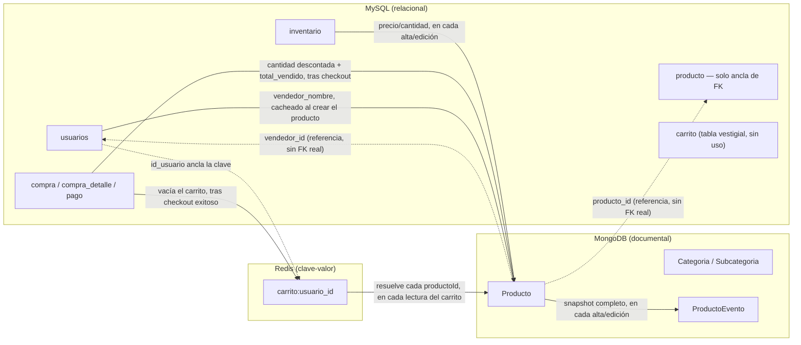
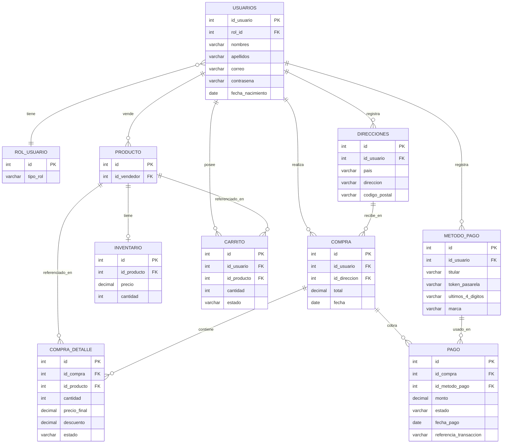

# ERD — Arquitectura políglota (estado actual, 2026-08-30)

> Este documento cubre las **tres bases de datos que corren hoy** (MySQL, MongoDB, Redis) y, sobre todo, **cómo interactúan entre sí** — que es lo que ningún documento individual cubre de punta a punta. No reemplaza a [ERD.md](ERD.md), que sigue siendo el registro histórico del modelo 100% relacional de la Fase Inicial (se mantiene sin editar a propósito). Tampoco reemplaza las decisiones ya documentadas en los ADR — acá se **consolida** lo que ya está decidido y construido, con referencias a cada ADR para el razonamiento completo, no se re-argumenta nada de cero.
>
> Neo4j (grafos, Entrega 2) todavía no es parte del sistema en funcionamiento — el modelo propuesto vive en [ENTREGA-2-PLAN.md §4.4](ENTREGA-2-PLAN.md#44-grafos-detección-de-fraude-neo4j), no acá. Este documento se actualizará cuando esa pieza exista de verdad.

---

## 1. Panorama general: quién es dueño de qué

| Base | Rol | Qué le pertenece |
|---|---|---|
| **MySQL** | Fuente transaccional única | Usuarios/auth, direcciones, métodos de pago, inventario (precio/cantidad reales), compras/pagos — todo lo que necesita ACID fuerte y ya tenía el checkout atómico de la Fase Inicial |
| **MongoDB** | Fuente del catálogo descriptivo + historial | Categorías, subcategorías, contenido de producto (descripción/atributos/imágenes/estado), historial de cambios por evento |
| **Redis** | Dato transitorio | Carrito de compra — TTL de 7.5 min, se puede perder sin consecuencia (no es fuente de verdad de nada) |

Ninguna base es dueña de un dato que otra también posea de forma autoritativa — donde una base necesita algo que "vive" en otra, lo tiene como **copia de lectura reenviada** (mejor esfuerzo, después del hecho) o como **referencia simple** (un id sin garantía de integridad referencial entre bases). El detalle exacto de cada caso está en la §5.

### 1.1 Diagrama de interacción



**Cómo leer las flechas:** línea sólida = dato que se copia/empuja de una base a otra (reenvío de mejor esfuerzo, o una lectura de resolución en el momento). Línea punteada = referencia simple — un id guardado como número/ObjectId plano, sin garantía de integridad entre bases (documentado así a propósito, ver [ADR-002](ADR-002-migracion-catalogo-documental.md), sección 6.3 "Relación producto–vendedor").

**Lo que NO existe, a propósito:** ninguna flecha vuelve de Mongo hacia MySQL, ni de Redis hacia MySQL o Mongo. Se evaluó y se descartó explícitamente un mecanismo bidireccional (worker de sincronización basado en el binlog de MySQL + Change Streams de Mongo) — ver [ADR-002 §3.5](ADR-002-migracion-catalogo-documental.md#35-considerado-y-descartado-2026-08-30-worker-de-sincronización-cdc-bidireccional): mapeado campo por campo, no apareció ningún dato real que necesitara viajar en sentido inverso.

---

## 2. MySQL (relacional)

Esquema completo en [`backend/prisma/schema.prisma`](../backend/prisma/schema.prisma). Desde el 2026-08-30 ([ADR-002 §3.4](ADR-002-migracion-catalogo-documental.md#34-actualización-2026-08-30-se-borra-el-catálogo-relacional-vestigial)) ya no incluye el catálogo relacional (`categoria`, `subcategoria`, `atributo_categoria`, `atributo_producto`, `categoria_producto`) — esas tablas se borraron por completo, no están vacías, no existen.

### 2.1 Entidades

| Entidad | PK | FK | Otros campos | Nota |
|---|---|---|---|---|
| `usuarios` | id_usuario | rol_id | nombres, apellidos, correo, contrasena, fecha_nacimiento | — |
| `rol_usuario` | id | — | tipo_rol | — |
| `direcciones` | id | id_usuario | pais, direccion, codigo_postal | — |
| `metodo_pago` | id | id_usuario | titular, token_pasarela, ultimos_4_digitos, marca | número completo/CVV nunca se guardan |
| `producto` | id | id_vendedor | — | **solo ancla de FK** desde Entrega 1 — lo descriptivo vive en Mongo |
| `inventario` | id | id_producto (único, 1:1) | precio, cantidad | fuente transaccional real de precio/stock |
| `carrito` | id | id_usuario, id_producto | cantidad, estado | **vestigial, sin uso** — el carrito real vive en Redis desde Entrega 2, esta tabla nunca se escribe ni se lee en código vivo |
| `compra` | id | id_usuario, id_direccion | total, fecha | — |
| `pago` | id | id_compra, id_metodo_pago | monto, estado, fecha_pago, referencia_transaccion | — |
| `compra_detalle` | id | id_compra, id_producto | cantidad, precio_final, descuento, estado | — |

### 2.2 Diagrama



---

## 3. MongoDB (documental)

Modelos en [`backend/src/models/mongo/`](../backend/src/models/mongo/). Mongoose como ODM, replica set de un nodo (`rs0`, ver [ADR-003](ADR-003-historial-cambios-eventos.md)).

### 3.1 Colecciones

| Colección (modelo) | Campo(s) clave | Referencia hacia otra base | Notas |
|---|---|---|---|
| `productos` (`Producto`) | `producto_id` (entero, no ObjectId) | `producto_id` → `producto.id` (MySQL); `vendedor_id` → `usuarios.id_usuario` (MySQL) | `inventario.{precio,cantidad}` es copia de lectura desde MySQL; `vendedor_nombre`/`total_vendido` son cachés de lectura |
| `categorias` (`Categoria`) | `_id` (ObjectId) | ninguna | sin relación con MySQL — el catálogo relacional se borró |
| `subcategorias` (`Subcategoria`) | `_id` (ObjectId) | `categoria_id` → `Categoria._id` (dentro de Mongo) | `atributos_definidos` reemplaza a la vieja `atributo_categoria` |
| `producto_eventos` (`ProductoEvento`) | `producto_id` (entero) | `producto_id` → `producto.id` (MySQL, vía `Producto.producto_id`); `usuario_id` → `usuarios.id_usuario` (MySQL) | append-only, cada evento es un snapshot completo — nunca se actualiza ni se borra un documento |

### 3.2 Forma de cada documento

Mermaid `erDiagram` no representa bien objetos anidados ni arrays variables (el problema real que motivó dejar el modelo relacional, ver [ADR-002 §1.1](ADR-002-migracion-catalogo-documental.md#11-el-catálogo-actual-fuerza-un-patrón-eav-para-poder-tener-atributos-distintos-por-categoría)) — para eso, la forma real de cada documento, tal como está en `Producto.js`/`Subcategoria.js`/`ProductoEvento.js`:

```jsonc
// productos
{
  "_id": "ObjectId",
  "producto_id": 1,                 // -> MySQL producto.id
  "descripcion": "...",
  "estado": "activo",
  "subcategoria_id": "ObjectId",    // -> subcategorias._id
  "vendedor_id": 2,                 // -> MySQL usuarios.id_usuario
  "vendedor_nombre": "Luis Ramírez",// caché de lectura
  "inventario": { "precio": 100.25, "cantidad": 39 }, // copia de lectura de MySQL inventario
  "atributos": [{ "nombre": "Talla", "valor": "M" }],
  "imagenes": [{ "url": "...", "alt": "...", "orden": 1, "principal": true }],
  "resenas_resumen": { "promedio": 0, "cantidad": 0 }, // decidido, no poblado todavía
  "total_vendido": 12,              // caché de lectura de MySQL compra_detalle
  "version": 3,
  "actualizado_en": "2026-08-30T..."
}

// subcategorias
{
  "_id": "ObjectId",
  "categoria_id": "ObjectId",       // -> categorias._id
  "subcategoria": "Camisetas",
  "atributos_definidos": ["Talla", "Color"]
}

// producto_eventos (append-only)
{
  "_id": "ObjectId",
  "producto_id": 1,                 // -> MySQL producto.id
  "version": 3,
  "tipo": "edicion",                // | "creacion"
  "fecha": "2026-08-30T...",
  "usuario_id": 2,                  // -> MySQL usuarios.id_usuario
  "campos_modificados": ["precio"],
  "snapshot": { /* descripcion, estado, atributos, imagenes, inventario — completo, no un delta */ }
}
```

### 3.3 Índices compuestos (requerimiento técnico de Entrega 1)

| Colección | Índice | Patrón de consulta que resuelve |
|---|---|---|
| `productos` | `{subcategoria_id: 1, total_vendido: -1}` | "más vendidos dentro de esta subcategoría" |
| `productos` | `{subcategoria_id: 1, 'inventario.precio': 1}` | "productos en este rango de precio dentro de esta subcategoría" |
| `producto_eventos` | `{producto_id: 1, fecha: -1}` | reconstrucción del historial por fecha |

---

## 4. Redis (clave-valor)

Un único patrón de clave hoy — ver [`backend/src/services/cartService.js`](../backend/src/services/cartService.js) y [ENTREGA-2-PLAN.md §4.1](ENTREGA-2-PLAN.md#41-carrito-en-redis-implementado-y-verificado-2026-08-30).

| Clave | Tipo | Forma | TTL |
|---|---|---|---|
| `carrito:{usuario.id_usuario}` | Hash | `{ "productoId": "cantidad", ... }` | 450s (7.5 min), reiniciado en **cualquier** interacción (lectura o escritura) — expiración por inactividad, no fija |

`usuario.id_usuario` en la clave es la misma referencia entera que en MySQL — no hay una tabla `carrito` real detrás en Redis, ni falta: el hash completo es el carrito. Al leer (`GET /api/carrito`), cada `productoId` se resuelve contra `productos` (Mongo) para traer descripción/precio/imagen vigentes — el carrito en sí nunca guarda una copia de esos datos, solo cantidades.

---

## 5. Interacciones cruzadas — detalle completo

Cada fila de acá es una flecha de la §1.1. `Mecanismo` distingue **reenvío** (push, después de un commit, mejor esfuerzo) de **referencia** (un id guardado, sin push) de **resolución en lectura** (se consulta la otra base en el momento de leer, no se copia nada).

| Origen → Destino | Dato | Mecanismo | Disparador | Dónde vive el código |
|---|---|---|---|---|
| MySQL `inventario` → Mongo `Producto.inventario` | precio, cantidad | Reenvío | Alta o edición de producto | `productoService.crear()` / `actualizar()` |
| MySQL `compra`/`compra_detalle` → Mongo `Producto.total_vendido` + `Producto.inventario.cantidad` | unidades vendidas, descuento de stock | Reenvío | Checkout exitoso (después de confirmada la transacción) | `checkoutService.checkout()` |
| MySQL `usuarios` → Mongo `Producto.vendedor_nombre` | nombre completo del vendedor | Reenvío (una sola vez) | Alta de producto | `productoService.crear()` |
| MySQL `usuarios` → Redis `carrito:{id}` | — | Referencia (la clave misma) | — | `cartService.js` |
| MySQL `compra` → Redis `carrito:{id}` | — (borra la clave entera) | Reenvío | Checkout exitoso | `checkoutService.checkout()` (server-side, garantizado) + `CartContext.jsx` (cliente, redundante) |
| Mongo `Producto.producto_id` → MySQL `producto.id` | — | Referencia, sin FK real | — | Todo el catálogo |
| Mongo `Producto.vendedor_id` → MySQL `usuarios.id_usuario` | — | Referencia, sin FK real | — | Todo el catálogo |
| Mongo `ProductoEvento.usuario_id` → MySQL `usuarios.id_usuario` | — | Referencia, sin FK real | — | Historial de cambios |
| Redis `carrito:{id}` → Mongo `productos` | descripción, precio, imagen vigentes | Resolución en lectura | Cada `GET /api/carrito` | `cartService.obtener()` |
| Mongo `producto_eventos` | snapshot completo de `Producto` | (interno a Mongo, no cruza bases) | Cada alta/edición | `productoService.crear()` / `actualizar()` |

**Reconciliación manual (admin), cuando el reenvío de mejor esfuerzo falla silenciosamente:**

| Endpoint | Recalcula | Desde |
|---|---|---|
| `POST /api/admin/recalcular-ventas` | `Producto.total_vendido` (Mongo) | MySQL `compra_detalle` (suma real) |
| `POST /api/admin/recalcular-inventario` | `Producto.inventario` (Mongo) | MySQL `inventario` (valor real) |

Ninguna de las dos reconstruye lo contrario (MySQL nunca se recalcula desde Mongo) — la dirección de "quién es la verdad" es siempre la misma, nunca se invierte.

---

## 6. Qué falta (Entrega 2 en curso)

- **Oferta de inventario limitado**: sumará un segundo patrón de clave en Redis (`oferta:{id}:stock`, contador atómico) — ver [ENTREGA-2-PLAN.md §4.2](ENTREGA-2-PLAN.md#42-oferta-de-inventario-limitado-el-ítem-de-mayor-peso-30-pts). Todavía no implementado.
- **Neo4j**: modelo cuentas-reseñas-productos propuesto en [ENTREGA-2-PLAN.md §4.4](ENTREGA-2-PLAN.md#44-grafos-detección-de-fraude-neo4j), bloqueado por implementar reseñas primero (§4.3 del mismo documento). No es parte del sistema todavía — este ERD no lo diagrama para no describir algo que no existe.
- **Reseñas** (Mongo, colección `resenas`): modelo decidido desde Entrega 1 ([ADR-002 §6.1](ADR-002-migracion-catalogo-documental.md#6-decisiones-de-modelado-embed-vs-reference)), nunca implementado. `Producto.resenas_resumen` ya existe en el schema, siempre en su valor por defecto.
