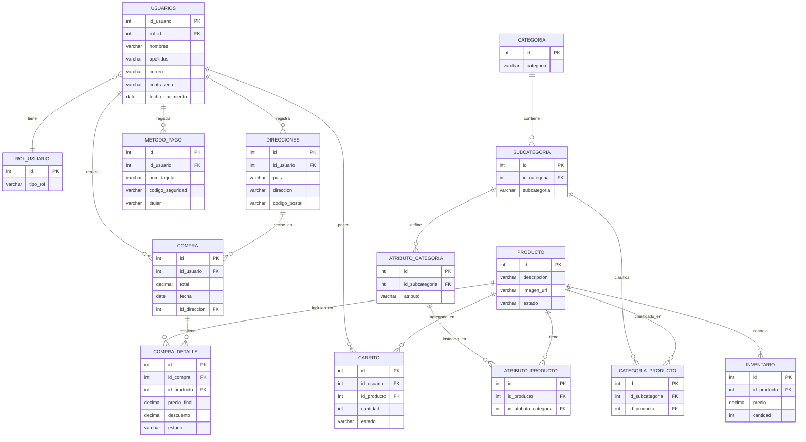

# ERD — TiendaYa (Fase Inicial)
## Análisis del diagrama entidad-relación

> Fuente: `Diagrama entidad relación Base de datos 2 , Tienda Ya.json` (exportado desde Lucidchart) · compartido por el equipo el 2026-08-22.
> Este documento transcribe y analiza el contenido del archivo para dejar registro versionado en el repositorio — el `.json` de Lucidchart no forma parte del proyecto en Git (ver pregunta abierta en §3 sobre si conviene agregarlo).

---

## 0. Resumen

El archivo contiene **dos páginas** con modelos de datos distintos:

| | Página 1 | Página 2 |
|---|---|---|
| Entidades | 14 | 21 |
| Alcance | Usuarios/direcciones, catálogo (categoría → subcategoría → atributos), inventario, carrito, compra/compra_detalle | Lo mismo salvo carrito/compra, más jerarquía geográfica (país/ciudad/departamento), un flujo de **reservas** en vez de compra directa, e historial de búsquedas con origen/destino de envío |
| Coincide con el alcance de Fase Inicial (PRD §5) | Sí, punto por punto | Parcialmente — agrega conceptos (geografía, reservas, envíos) que el PRD no menciona |
| Consistencia interna | Buena, con detalles menores (§1.4) | Varias inconsistencias: nombres duplicados, tablas repetidas, una PK sin nombre real (§2.2) |

**Recomendación:** usar **Página 1** como base del modelo relacional de la Fase Inicial — cubre exactamente lo que pide el PRD (usuarios y direcciones, categorías y productos, pedidos y líneas de pedido, inventario) y es internamente más consistente. Página 2 se documenta igual en la sección 2 por completitud: puede que ahí se haya explorado una idea previa antes de simplificar a Página 1, o que algunas piezas se quieran retomar más adelante. Confirmarlo es la primera pregunta abierta (§3) — nada de esto se implementa todavía.

---

## 1. Página 1 — Modelo propuesto para Fase Inicial

### 1.1 Entidades

| Entidad | PK | FK | Otros campos |
|---|---|---|---|
| `usuarios` | id_usuario | rol_id | nombres, apellidos, correo, contraseña, fecha_nacimiento (date) |
| `rol_usuario` | id | — | tipo_rol |
| `direcciones` | id | id_usuario | pais, direccion, codigo_postal (**decimal** ⚠) |
| `metodo_pago` | id | id_usuario | num_tarjeta (**decimal** ⚠), codigo_seguridad (**decimal** ⚠), titular |
| `producto` | id | — | descripcion, imagen_url, estado |
| `categoria` | id | — | categoria |
| `subcategoria` | id | id_categoria | subcategoria |
| `inventario` | id | id_producto | precio (decimal), cantidad (int) |
| `atributo_categoria` | id | id_subcategoria | atributo |
| `atributo_producto` | id | id_producto, id_atributo_categoria | ⚠ sin campo de valor (ver 1.4.3) |
| `categoria_producto` | id | id_subcategoria, id_producto | — (tabla pivote) |
| `carrito` | id | id_usuario, id_producto | cantidad, estado |
| `compra` | id | id_usuario, id_direccion | total (decimal), fecha (date) |
| `compra_detalle` | id | id_compra, id_producto | precio_final, descuento, estado |

### 1.2 Diagrama

> Las cardinalidades de este diagrama reflejan lo que implican las columnas FK declaradas en cada entidad. No siempre coinciden con las puntas de flecha del archivo original de Lucidchart — ver observaciones 1.4.5 a 1.4.7.

### 1.3 Nota sobre el método de extracción

Todo lo anterior se extrajo de los datos estructurados del `.json` (figuras, campos y conectores), no de una lectura visual del diagrama renderizado. Donde el archivo tenía ambigüedades se documentan como observaciones abajo en vez de "corregirse" silenciosamente.

### 1.4 Observaciones y recomendaciones

1. **Falta una entidad de pago transaccional.** El PRD (§3, §5) pide cubrir "Pagos" en el modelo base. `metodo_pago` guarda el instrumento del usuario (tarjeta), pero ninguna tabla registra el cobro real de una compra (monto, estado, fecha, referencia de la pasarela). Sin esto, la transacción atómica de checkout (pedido + líneas + **pago** + descuento de inventario, PRD §5) no tiene dónde escribir el pago. Se recomienda agregar `pago (id, id_compra FK, id_metodo_pago FK, monto, estado, fecha_pago, referencia_transaccion)`.

2. **Datos de tarjeta: tipo y seguridad.** `metodo_pago.num_tarjeta` y `codigo_seguridad` están tipados `decimal`. Un número de tarjeta no es un valor aritmético (pierde ceros a la izquierda) y debe ser `varchar`. Más importante: persistir el código de seguridad (CVV) — incluso cifrado — no cumple PCI-DSS; ninguna aplicación debería guardarlo después de autorizar el pago. La Página 2 sí modela `tarjeta_encriptada` sin CVV — es la práctica a seguir. Recomendación: quitar `codigo_seguridad` del modelo y cifrar/tokenizar `num_tarjeta` (idealmente delegar el dato completo de la tarjeta a la pasarela de pago y guardar solo un token de referencia).

3. **`atributo_producto` no tiene campo de valor.** Vincula `producto` con `atributo_categoria`, pero no guarda el valor concreto (p. ej. atributo "Color", valor "Rojo"). Así como está, no se puede representar el atributo variable por categoría que pide el PRD (§3). Agregar `valor varchar`.

4. **`codigo_postal` como `decimal`.** Muchos códigos postales tienen ceros a la izquierda o letras (Reino Unido, Canadá); usar `varchar`.

5. **La relación `usuarios`–`compra` no está dibujada.** `compra.id_usuario` existe como FK en la tabla, pero la línea que debería unir `compra` con `usuarios` en el archivo en realidad conecta `compra_detalle` con `usuarios` (línea `p9rn8REtk6FQ`) — y `compra_detalle` no tiene columna `id_usuario`. Parece un error de trazado en Lucidchart (se enganchó la figura vecina). El diagrama de la sección 1.2 usa la relación correcta según la FK declarada; falta corregir el conector en el archivo original.

6. **Cardinalidad `inventario`↔`producto` y `carrito`↔`producto`.** El archivo dibuja ambas con `producto` del lado "muchos", pero `inventario.id_producto` y `carrito.id_producto` son FK — lo esperable es lo contrario (`producto` del lado "uno"). Si el inventario es estrictamente 1:1 por producto, conviene una restricción `UNIQUE` sobre `inventario.id_producto`; si se planea inventario por bodega o lote, falta una columna que distinga esa dimensión (p. ej. `almacen_id`).

7. **Varios conectores muestran "uno a uno" en ambos extremos** (`usuarios`–`rol_usuario`, `atributo_categoria`–`atributo_producto`, `usuarios`–`carrito`) donde la FK sugiere "uno a muchos". Vale la pena revisar las puntas de flecha directamente en Lucidchart antes de darlo por definitivo.

---

## 2. Página 2 — Modelo extendido (referencia)

Se documenta por completitud, ya que estaba en el archivo compartido. No se recomienda como base de la Fase Inicial (ver §0).

### 2.1 Entidades

| Entidad | PK | FK | Otros campos | Nota |
|---|---|---|---|---|
| `Tipo_departamento` (1) | id | Tipo | detalles, Propiedades | nombre repetido, ver 2.2 |
| `Inventario` | id | categoria_id, producto_id | cantidad, imagen_url | — |
| `usuarios` | id_usuario | pais, rol_id | nombres, apellidos, correo, contraseña, fecha_nacimiento (**int** ⚠) | fecha_nacimiento es `date` en Página 1 |
| `Ciudad` | id | Pais_id | ciudad, ubicacion | — |
| `Pais` | id | — | pais_nombre (unique), imagen_url | — |
| `rol_usuario` | id | — | tipo_rol | — |
| `compra_usuario` | id | reserva_id, usuario_id | nit, tarjeta_encriptada, fecha_pago | tarjeta cifrada — mejor práctica que `metodo_pago` de Página 1 |
| `busquedas_producto` | id | usuario_id, categoria_id, departamento_id, pais_id | origen_pais, origen_ciudad, destino_pais, destino_ciudad, fecha_envio, fecha_busqueda | parece un registro de envíos/logística, fuera del alcance descrito en el PRD |
| `Departamentos_multiples` | — | departamentos_id, categoria_id, busqueda_id | — | tabla pivote sin PK propio |
| `producto` | id | inventario_id, categoria_id | precio, detalles_vendedor, atributos_producto, detalles_propios_producto (unique) | — |
| `Reservas_producto` | id | usuario_id, producto_id, categoria_id, inventario_id | fecha_reserva, precio_total, estado, fecha_compra | reemplaza el flujo carrito+compra de Página 1 |
| `Detalles_producto_reservado_multiples` | — | detalle_producto_reservado, producto_id | — | mismos campos que `multiples_producto_reservados` |
| `Categoria` | id | departamento_productos, pais_id | categoria_principal | — |
| `Categoria_producto_pivote` | id (marcado **fk**, no pk ⚠) | id_producto, busqueda_producto_id | sub_categoria | — |
| `Tipo_departamento` (2) | — | Tipo_departamento, departamento_id | — | mismo nombre que (1), sin PK, parece pivote |
| `Pais_multiple` | — | pais_id, categoria_id | — | sin PK |
| `Historial_reservas` | id | reserva_id, usuario_id | accion, fecha_accion, detalles | — |
| `Tipos_departamento` | id | — | nombre | tercer concepto de "departamento" (ver 2.2) |
| `Detalles_producto_reservado` | **"int"** (pk) ⚠ | producto_id, reserva_producto, inventario_id | — | el nombre de la columna PK es literalmente "int" — probable error de tipeo |
| `Departamentos` | id | Tipo | nombre | — |
| `multiples_producto_reservados` | — | detalle_producto_reservado, producto_id | — | mismos campos que `Detalles_producto_reservado_multiples` |

### 2.2 Inconsistencias detectadas

- **Cuatro figuras para el concepto "departamento":** `Tipo_departamento` (con detalles/propiedades), otra tabla también llamada `Tipo_departamento` (solo dos FK, aparenta ser pivote), `Tipos_departamento` (id + nombre) y `Departamentos` (id + Tipo + nombre). No queda claro cuál es el departamento, cuál su tipo/categoría y cuál la tabla de unión.
- **Dos tablas pivote idénticas:** `Detalles_producto_reservado_multiples` y `multiples_producto_reservados` tienen exactamente los mismos campos (`detalle_producto_reservado`, `producto_id`) — parece un duplicado por copiar/pegar.
- **`Detalles_producto_reservado`** tiene su PK con el nombre de columna literalmente "int", en vez de un nombre real (p. ej. `id`).
- **`usuarios.fecha_nacimiento` es `int` aquí, pero `date` en Página 1** — inconsistencia entre páginas del mismo archivo.
- **Varias tablas pivote no declaran PK** (`Departamentos_multiples`, `Tipo_departamento` (2), `Pais_multiple`) — puede ser intencional (PK compuesta por las FK) pero no está indicado explícitamente.
- **Agrega alcance no mencionado en el PRD:** jerarquía geográfica completa (país → ciudad → departamento) y seguimiento de búsquedas con origen/destino de envío. Ninguna funcionalidad de TiendaYa descrita en el PRD requiere esto en la Fase Inicial.

---

## 3. Preguntas abiertas

- ¿Confirman **Página 1** como base para implementar la Fase Inicial?
- ¿Se agrega una entidad `pago` explícita, separada de `metodo_pago` (observación 1.4.1)?
- ¿Se elimina el almacenamiento de CVV y se cifra/tokeniza el número de tarjeta (observación 1.4.2)?
- ¿Alguna pieza de Página 2 (país/ciudad para direcciones internacionales, patrón de reservas) es intencional para una entrega posterior, o se descarta?
- ¿Se agrega el archivo fuente del diagrama (`.json` de Lucidchart, o una exportación PNG/SVG) al repositorio — p. ej. en `IA/diagramas/` — para que quede accesible sin depender de una cuenta de Lucidchart?
